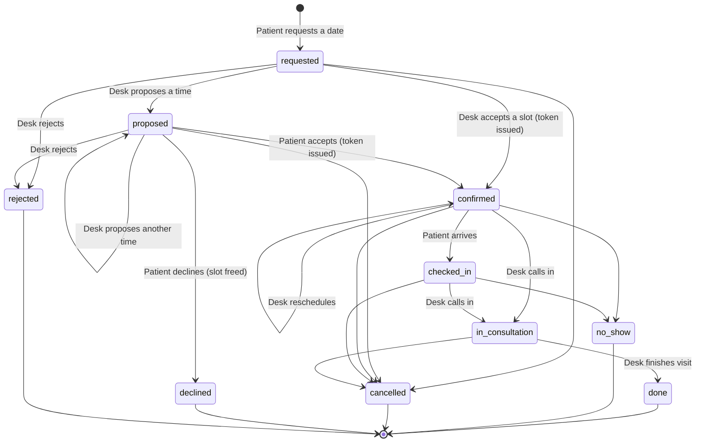
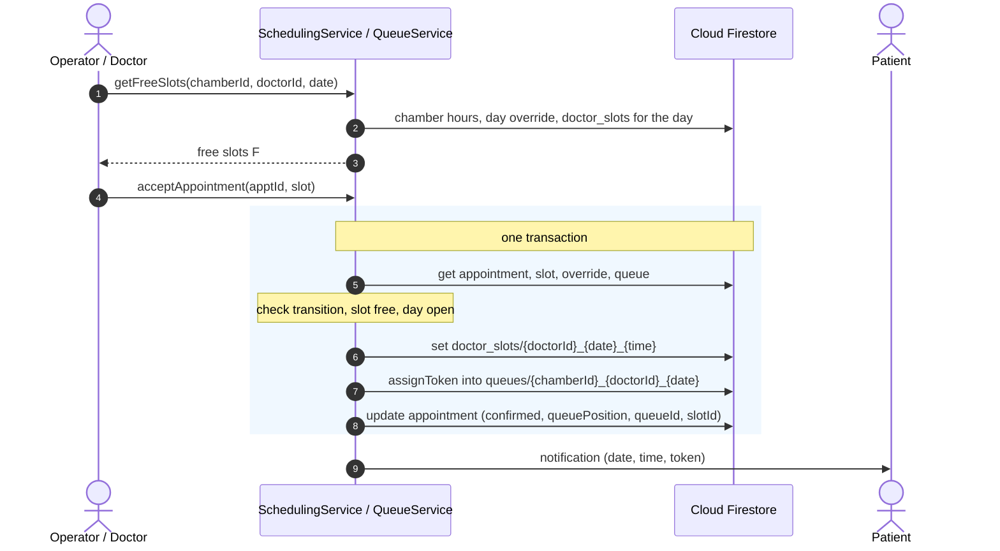

# DocDesk Appointment Scheduling Algorithm Specification

## 1. Introduction and Problem Context

Outpatient clinical care in Bangladesh operates predominantly through multi-chamber specialist consultations. A specialist medical practitioner typically consults at multiple physical chambers (e.g., diagnostic centers, private hospitals, and clinics) across distinct time blocks within a week.

Traditional clinical queues in this environment rely either on purely unreserved First-Come, First-Served (FCFS) walk-in queuing or on rigid, static time-slot booking systems. Both paradigms exhibit critical failure modes in practice:
- **FCFS Walk-in Queuing**: Patients endure volatile waiting times averaging 2 to 4 hours in crowded waiting rooms. No upper bound on patient intake is guaranteed, leading to clinical overcrowding and sudden walk-in rejections late in the evening.
- **Static Fixed-Slot Scheduling**: Doctors frequently face traffic delays, emergency hospital rounds, or surgical overruns. If a doctor arrives 45 minutes late, a static slot system collapses: all subsequent slots are instantly misaligned, creating cascading confusion, missed appointments, and frustrated patients.

DocDesk addresses this reality through a **Dynamic Constrained-Window Timed-Slot Reservation Model with Atomic Distributed Locks**. This architecture combines:
1. Deterministic timed slot reservations with sequential chamber queue positions.
2. Dynamic operator- or doctor-adjustable day overrides (allowing dynamic shifts in consultation start/end windows without silent cancellation).
3. Cross-chamber global doctor conflict avoidance through $O(1)$ deterministic document locks in Cloud Firestore.
4. Guaranteed atomic state transitions ensuring zero double-booking even under concurrent booking submissions across disparate chambers.

---

## 2. Requirements Specification

### 2.1 Functional Requirements (FR)

- **FR1 (Preferred Date Request)**: A patient can submit an appointment request specifying a doctor, chamber, and preferred date. At the request stage, no specific time slot or sequential queue number is assigned.
- **FR2 (Exclusive Triage Authority)**: The designated chamber desk operator (or the doctor directly if no operator is assigned to the chamber) possesses exclusive authority to `Accept`, `Reschedule`, or `Reject` (with a mandatory clinical/administrative reason) pending requests.
- **FR3 (Constrained Free-Slot Generation)**: The system dynamically computes the discrete set of valid free consultation slots for a target date using the chamber's weekly schedule, effective slot length, and any active daily overrides. Only system-enumerated free slots may be selected during acceptance or rescheduling.
- **FR4 (Cross-Chamber Global Invariant)**: A doctor cannot be scheduled for two concurrent active/confirmed consultations at any time, across any combination of chambers.
- **FR5 (Deterministic Sequential Queue Allocation)**: Upon appointment confirmation, the system assigns a monotonically increasing, non-reusable token specific to the doctor, chamber and consultation date (`queues/{chamberId}_{doctorId}_{yyyyMMdd}`, see 3.3).
- **FR6 (Dynamic Daily Overrides)**: A doctor or authorized chamber operator can dynamically adjust a consultation date's start and end times, declare the day `closed`, mark it `full`, or `reopen` it.
- **FR7 (Automatic Saturation)**: Daily capacity is strictly derived from the consultation window duration and slot length. When confirmed appointments reach capacity ($N$), the date is marked as saturated (`full`), preventing subsequent reservations.
- **FR8 (Bi-directional Patient Notification)**: Patients receive automated in-app notifications for every state transition, explicitly indicating old and new consultation times on rescheduling and reasons on rejection.
- **FR9 (Slot Deallocation on Cancellation)**: When a patient cancels or an operator/doctor rejects an appointment, the associated time slot is immediately released and made available for reservation.

### 2.2 Non-Functional Requirements (NFR)

- **NFR1 (Consistency & Atomicity)**: Slot reservation and queue assignment must execute in a single atomic database transaction ($ACID$). Concurrent confirmation attempts on the same doctor time slot must guarantee that exactly one transaction succeeds while conflicting transactions abort cleanly.
- **NFR2 (Security & Principle of Least Privilege)**: Patients cannot modify time slots or daily overrides. Their only queue writes are taking a token when they accept a proposed time and giving it up when they cancel. Security rules in `firestore.rules` enforce these constraints independently of UI controls.
- **NFR3 (Algorithmic Performance)**: 
  - Slot collision validation and reservation operate in $O(1)$ time via deterministic document IDs (`doctor_slots/{doctorId}_{yyyyMMdd}_{HHmm}`).
  - Free slot generation operates in $O(S)$ time, where $S \le 96$ is the total slots in a daily window ($S \le 16\text{ hours} \times 6\text{ slots/hr}$). No unbounded collection scans are performed.
- **NFR4 (Availability & Fault Resilience)**: Read operations leverage local Firestore persistence caching. Mutation operations require active connectivity; write failures produce clear, actionable error messages.
- **NFR5 (Ergonomics & Usability)**: All appointment times are formatted in standard 12-hour format (`hh:mm a`). Touch targets conform to a minimum dimension of $48\text{ dp}$, and text elements maintain a minimum contrast ratio of $4.5:1$ against backgrounds.
- **NFR6 (Patient Privacy Preservation)**: Patients are restricted from reading other patients' names, records, or appointment specifics. Publicly accessible schedule endpoints expose only aggregate capacity indicators (e.g., "$k$ slots left").
- **NFR7 (Auditability & Traceability)**: Every state mutation records `updatedBy` (UID of the initiating actor) and `updatedAt` (server timestamp). BM&DC verification updates remain append-only.
- **NFR8 (Temporal Determinism)**: All calendar date computations, slot partitions, and cutoffs are evaluated in the official Bangladesh Standard Time zone (`Asia/Dhaka`, $\text{UTC}+6$). Timestamps are persisted as native UTC `Timestamp` primitives.
- **NFR9 (Maintainability & Test Coverage)**: Centralized query builders and scheduling services encapsulate all domain logic, fully verified via automated Cloud Firestore emulator suites.

---

## 3. Mathematical Formulation and Algorithm

### 3.1 Definitions

Let:
- $c \in \mathcal{C}$ denote a specific chamber.
- $d \in \{0, 1, \dots, 6\}$ denote the day of the week, where $0 = \text{Sunday}, \dots, 6 = \text{Saturday}$.
- $W(c, d) = [T_{\text{start}}, T_{\text{end}}]$ represent the baseline weekly consultation window for chamber $c$ on day $d$.
- $L_c \in [5, 15] \subset \mathbb{Z}^+$ denote the consultation slot duration in minutes (default $L_c = 10$).
- $O(c, \text{date})$ denote an optional administrative override for chamber $c$ on a calendar date:
  $$O(c, \text{date}) = \langle T'_{\text{start}}, T'_{\text{end}}, L'_c, \text{status} \rangle$$
  where $\text{status} \in \{\text{open}, \text{closed}, \text{full}\}$.
- The **effective consultation window** $E(c, \text{date})$ is defined as:
  $$E(c, \text{date}) = \begin{cases} \emptyset & \text{if } O(c, \text{date}).\text{status} \in \{\text{closed}, \text{full}\} \\ [T'_{\text{start}}, T'_{\text{end}}] & \text{if } O(c, \text{date}) \text{ exists with status } \text{open} \\ W(c, d) & \text{otherwise} \end{cases}$$

### 3.2 Capacity and Slot Generation

Given effective window $E(c, \text{date}) = [T_s, T_e]$ and effective slot length $L$:
1. **Capacity** $N$:
   $$N = \left\lfloor \frac{T_e - T_s}{L} \right\rfloor$$
   *Example*: For $T_s = \text{17:00}$ (5:00 PM), $T_e = \text{21:00}$ (9:00 PM), and $L = 10\text{ minutes}$:
   $$N = \left\lfloor \frac{240\text{ min}}{10\text{ min}} \right\rfloor = 24\text{ slots}$$

2. **Total Slot Set** $S(c, \text{date})$:
   $$S(c, \text{date}) = \{ T_s + i \cdot L \mid 0 \le i < N \}$$

3. **Free Slot Set** $F(c, \text{doctorId}, \text{date})$:
   Let $U(\text{doctorId}, \text{date})$ be the set of slots currently reserved across all chambers for doctor $\text{doctorId}$ on $\text{date}$, retrieved from collection `doctor_slots`.
   Let $P(\text{now})$ denote the set of slots in the past if $\text{date} = \text{today}_{\text{Dhaka}}$.
   $$F(c, \text{doctorId}, \text{date}) = \begin{cases} \emptyset & \text{if } E(c, \text{date}) = \emptyset \\ S(c, \text{date}) \setminus U(\text{doctorId}, \text{date}) \setminus P(\text{now}) & \text{otherwise} \end{cases}$$

---

### 3.3 Per-Doctor Daily Queue

Implemented in `lib/services/queue_service.dart` (`QueueService`), with slot
generation and acceptance in `lib/services/scheduling_service.dart`.

There is one queue document per doctor, per chamber, per day:

```
queues/{chamberId}_{doctorId}_{yyyyMMdd}
```

`firestore.rules` rejects a queue write whose ID does not equal
`chamberId + "_" + doctorId + "_" + date` from its own fields, so two doctors
sharing a chamber never share token numbers.

| Field | Meaning |
| :--- | :--- |
| `chamberId`, `doctorId`, `date` | Owner of the queue; `date` is `yyyyMMdd` |
| `lastNumber` | Last token handed out. Only ever grows, so tokens are never reused |
| `currentServing` | Token now in consultation (0 when idle) |
| `currentAppointmentId` | Appointment now in consultation (empty when idle) |
| `waitingTokens` | Tokens still waiting, ascending |
| `waitingCount` | Length of `waitingTokens` |
| `lastTouchedAppointmentId`, `updatedAt` | Audit of the last write |

The queue holds token numbers only. Any signed-in user may read it, so a
patient can compute "people ahead" (waiting tokens lower than their own)
without being able to read anyone else's appointment.

Older builds wrote `lastQueuePosition` under a chamber-only ID
(`queues/{chamberId}_{yyyyMMdd}`). `nextToken()` takes the larger of
`lastNumber` and `lastQueuePosition`, so numbers never repeat after the switch.

**Token assignment** (`assignToken`, run inside the confirming transaction):

```
newQueue <- queues/{chamberId}_{doctorId}_{dateKey(slot)}
if the appointment already holds a token in newQueue:
    token <- that token                      // rescheduled within the same day
else:
    token <- max(lastNumber, lastQueuePosition) + 1
    if the appointment held a token in another day's queue:
        remove it from that queue's waitingTokens
add token to newQueue.waitingTokens; lastNumber <- max(lastNumber, token)
appointment.queuePosition <- token; appointment.queueId <- newQueue.id
```

Joining and leaving use `joinWrite()` and `leaveWrite()`. Leaving (called in,
cancelled, no-show) removes the token from `waitingTokens`; when nothing is
waiting and nobody is in consultation, `currentServing` resets to 0 while
`lastNumber` is kept.

### 3.4 Appointment Lifecycle

Statuses are defined in `ApptStatus`. `QueueService.transitions` mirrors
`allowedNext()` in `firestore.rules`, and every service method checks
`canTransition()` inside its transaction before writing.

| From | Allowed next |
| :--- | :--- |
| `requested` | `proposed`, `confirmed`, `rejected`, `cancelled` |
| `proposed` | `proposed`, `confirmed`, `declined`, `rejected`, `cancelled` |
| `confirmed` | `confirmed` (reschedule), `checked_in`, `in_consultation`, `no_show`, `cancelled` |
| `checked_in` | `in_consultation`, `no_show`, `cancelled` |
| `in_consultation` | `done`, `cancelled` |

Terminal: `done`, `no_show`, `cancelled`, `declined`, `rejected`. Legacy
values are read through `normalizeStatus()`: `in_progress` becomes
`in_consultation`, `completed` becomes `done`.

| Step | Who | Method | Effect |
| :--- | :--- | :--- | :--- |
| Request | Patient | `FirestoreService` booking | `requested`; an `active_bookings` lock stops duplicate requests for the same doctor, chamber and day |
| Accept | Desk (operator, or the doctor if no operator) | `SchedulingService.acceptAppointment` | `requested -> confirmed`; reserves `doctor_slots/{doctorId}_{yyyyMMdd}_{HHmm}` and assigns a token |
| Propose a time | Desk | `QueueService.proposeTime` | `-> proposed`; reserves the slot so it can't be offered twice; no token yet |
| Answer proposal | Patient | `QueueService.respondToProposal` | accept: `-> confirmed` and takes a token; decline: `-> declined` and frees the slot |
| Reschedule | Desk | `SchedulingService.rescheduleAppointment` | stays `confirmed`; moves the slot and, if the day changes, the token to the new day's queue |
| Check in | Desk | `QueueService.checkIn` | `confirmed -> checked_in` (patient has arrived) |
| Call in | Desk | `QueueService.startConsultation` | `-> in_consultation`; sets `currentServing`, removes the token from `waitingTokens`, sets `autoAdvanceAt` to now + the doctor's `avgConsultMinutes` (default 10), then sends "You're next" once to the lowest waiting token (`nextNotifiedAt`) |
| Finish | Desk | `QueueService.finishVisit(outcome)` | `in_consultation -> done`, or `confirmed`/`checked_in -> no_show`/`cancelled`; releases the token or clears `currentAppointmentId` |
| Cancel | Patient | `QueueService.cancelByPatient` | only from `requested`, `proposed`, `confirmed`; gives up the token |

Only one patient per queue can be `in_consultation`: `startConsultation`
refuses while `currentAppointmentId` points at an appointment still in
consultation. `autoAdvanceAt` only turns the desk's consult timer red; a visit
is never ended automatically.



### 3.5 System Invariants

- **$I_1$ Doctor slot exclusivity**: `doctor_slots/{doctorId}_{yyyyMMdd}_{HHmm}`
  holds at most one `appointmentId`, so a doctor cannot be booked twice in the
  same slot across chambers.
- **$I_2$ Capacity bound**: confirmed appointments for a chamber day never
  exceed $N$, because only enumerated free slots can be chosen.
- **$I_3$ Monotonic tokens**: within `queues/{chamberId}_{doctorId}_{date}`,
  `lastNumber` only increases and a token is never handed out twice. The rules
  require a newly assigned `queuePosition` to equal the queue's new `lastNumber`.
- **$I_4$ Single active booking**: at most one `active_bookings` lock per
  patient, doctor, chamber and date.
- **$I_5$ One in consultation**: at most one appointment per queue is
  `in_consultation`.

### 3.6 Comparative Analysis

| Dimension | Pure FCFS Walk-in | Static Fixed-Slot | DocDesk |
| :--- | :--- | :--- | :--- |
| **Arrival predictability** | None | High on paper, brittle in practice | Slot time plus token number |
| **Doctor delay tolerance** | High | Low | High: desk shifts the window or proposes a new time |
| **Waiting room crowding** | Severe | Low until a delay | Low: paced arrivals and live "people ahead" |
| **Cross-chamber protection** | None | Vulnerable | Atomic `doctor_slots` lock |
| **Queue position retention** | Lost if patient steps away | None | Token kept until called, cancelled or no-show |

---

## 4. Sequence: Desk Accepts a Request


