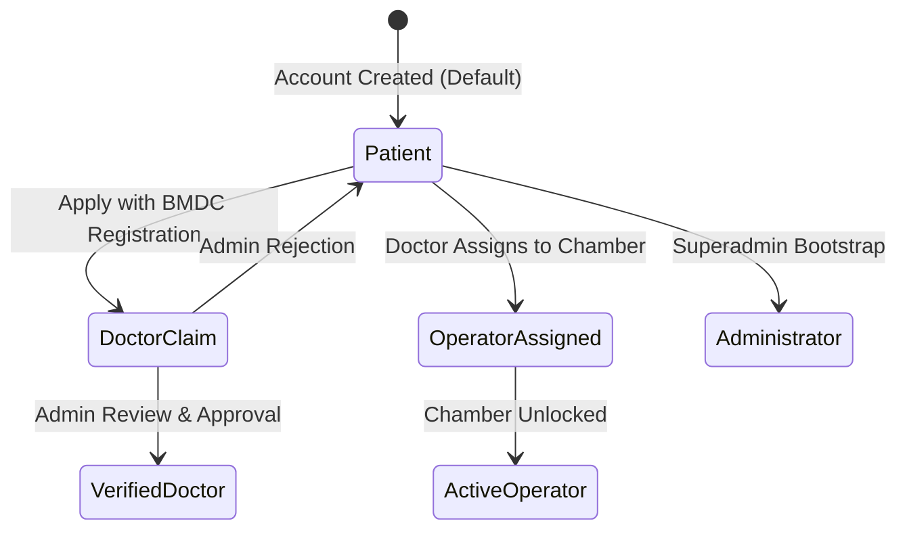
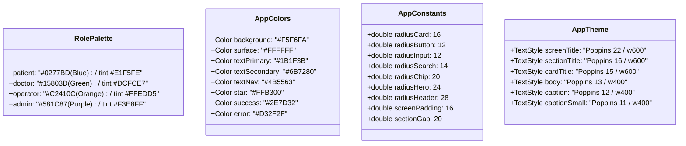
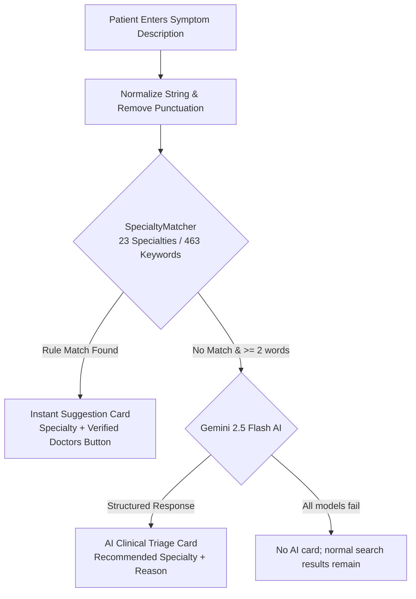
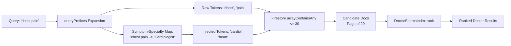
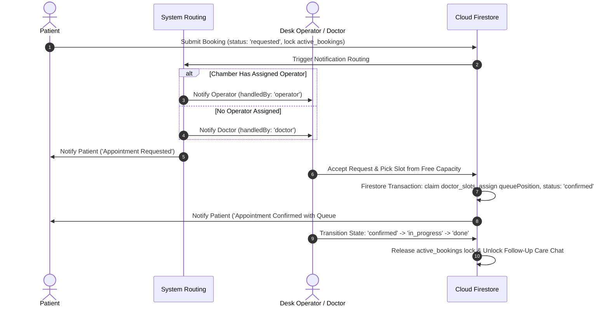
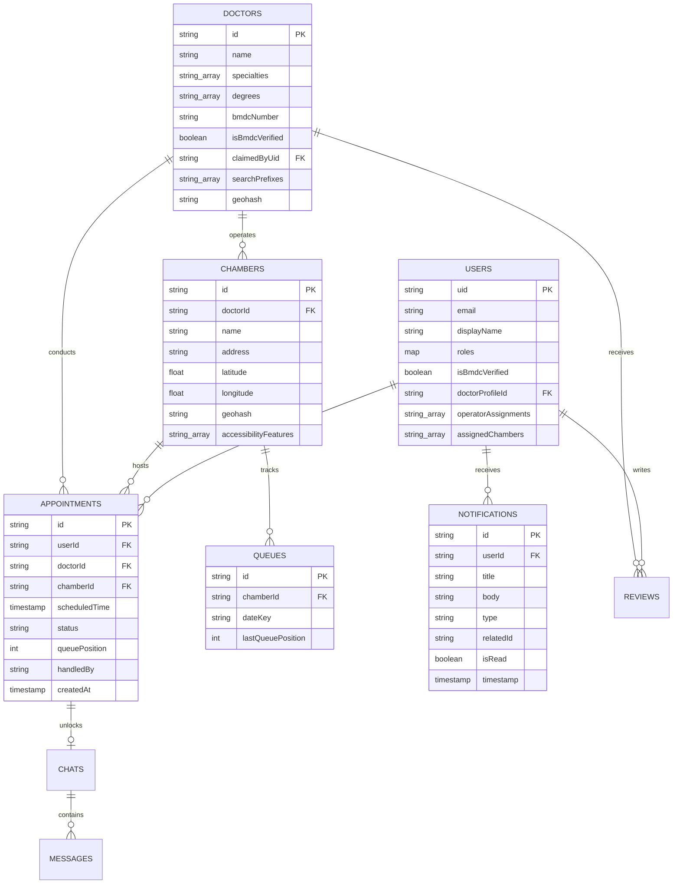

# Software Requirements Specification (SRS)

## Project: DoctorDesk — Smart Healthcare Coordination, Clinical Triage & Real-Time Queue Management Platform

---

### Document Control

| Attribute | Details |
| :--- | :--- |
| **Document Version** | 2.1.0 (Verified against code) |
| **Document Status** | Approved / Living Specification |
| **Target Platform** | Flutter (Android first; iOS builds but is not configured for Google Sign-In) + Firebase + Gemini |
| **Firebase Project** | `docdesk-1e4cc` |
| **Last Updated** | November 2026 |
| **Standard Compliance** | IEEE Std 830-1998 / ISO/IEC/IEEE 29148:2018 |

---

### Revision History

| Version | Date | Author / Contributor | Description of Changes |
| :--- | :--- | :--- | :--- |
| **1.0.0** | September 2026 | Core Architecture Team | Initial prototype specification: Express + MongoDB backend, basic BMDC verification concept, early role hierarchy. |
| **1.5.0** | October 2026 | Engineering Team | Serverless migration to Cloud Firestore, 50k reads limit mitigation strategy, pre-bundled 6,000+ APK doctor directory, Geohash proximity engine. |
| **2.0.0** | November 2026 | Mobile & Systems Team | Full production specification: Bidirectional symptom↔specialty indexing (v2), Gemini 2.5 Flash triage fallback, Universal Accessibility (Global Read Aloud TTS & Doctor-Declared Disability Chambers), strict booking state machine & queue transactions, role-based Material 3 design token architecture, and assisted BM&DC administrative verification. |
| **2.1.0** | November 2026 | Mobile & Systems Team | Checked every requirement against the code (commit `e102c21` plus the pre-demo UI polish). Corrected role colours, booking status names, lock key format, queue counter fields, triage coverage and fallback, nearby search, vault storage, operating environment, index list and test counts. Unbuilt items moved to [section 8](#8-not-implemented--open-issues). |

---

## Table of Contents

1. [Introduction](#1-introduction)
   - 1.1 [Purpose](#11-purpose)
   - 1.2 [Scope](#12-scope)
   - 1.3 [Definitions, Acronyms, and Abbreviations](#13-definitions-acronyms-and-abbreviations)
   - 1.4 [Architectural Evolution](#14-architectural-evolution)
   - 1.5 [High-Level Architecture & Component Diagram](#15-high-level-architecture--component-diagram)
2. [Overall Description](#2-overall-description)
   - 2.1 [Product Perspective](#21-product-perspective)
   - 2.2 [Supported User Roles & Thematic Portals](#22-supported-user-roles--thematic-portals)
   - 2.3 [User Role State Machine & Transitions](#23-user-role-state-machine--transitions)
   - 2.4 [Operating Environment](#24-operating-environment)
   - 2.5 [Design & Implementation Constraints](#25-design--implementation-constraints)
   - 2.6 [Assumptions and Dependencies](#26-assumptions-and-dependencies)
3. [External Interface Requirements](#3-external-interface-requirements)
   - 3.1 [User Interfaces & Design Token System](#31-user-interfaces--design-token-system)
   - 3.2 [Hardware Interfaces](#32-hardware-interfaces)
   - 3.3 [Software Interfaces & Cloud Integrations](#33-software-interfaces--cloud-integrations)
   - 3.4 [Communications Interfaces](#34-communications-interfaces)
4. [System Features & Functional Requirements](#4-system-features--functional-requirements)
   - 4.1 [Authentication & Global Identity Management](#41-authentication--global-identity-management)
   - 4.2 [Two-Tier Clinical Triage Engine](#42-two-tier-clinical-triage-engine)
   - 4.3 [Search Indexing, Geospatial Discovery & Directory Architecture](#43-search-indexing-geospatial-discovery--directory-architecture)
   - 4.4 [Chamber Queue Operations & Dynamic Scheduling Algorithm](#44-chamber-queue-operations--dynamic-scheduling-algorithm)
   - 4.5 [Universal Accessibility & Disability-Friendly Chambers](#45-universal-accessibility--disability-friendly-chambers)
   - 4.6 [Post-Care Telemedicine & Follow-Up Messaging](#46-post-care-telemedicine--follow-up-messaging)
   - 4.7 [Patient Health Document Vault & Medical Journal](#47-patient-health-document-vault--medical-journal)
   - 4.8 [Administrative Console & BM&DC Verification Portal](#48-administrative-console--bmdc-verification-portal)
5. [Non-Functional Requirements](#5-non-functional-requirements)
   - 5.1 [Performance & Quota Optimization](#51-performance--quota-optimization)
   - 5.2 [Security & Data Protection](#52-security--data-protection)
   - 5.3 [Reliability, Availability & Offline Resilience](#53-reliability-availability--offline-resilience)
   - 5.4 [Usability & Universal Accessibility](#54-usability--universal-accessibility)
   - 5.5 [Maintainability & Code Hygiene](#55-maintainability--code-hygiene)
6. [Data Model & Firestore Schema Specifications](#6-data-model--firestore-schema-specifications)
   - 6.1 [Entity Relationship Diagram](#61-entity-relationship-diagram)
   - 6.2 [Firestore Collection Schemas](#62-firestore-collection-schemas)
   - 6.3 [Composite Index Specifications](#63-composite-index-specifications)
7. [Verification, Validation & Quality Gates](#7-verification-validation--quality-gates)
   - 7.1 [Firestore Rules Unit Test Suite](#71-firestore-rules-unit-test-suite)
   - 7.2 [Static Analysis & Code Quality Gate](#72-static-analysis--code-quality-gate)
   - 7.3 [Booking Lifecycle Acceptance Matrix](#73-booking-lifecycle-acceptance-matrix)
8. [Not Implemented / Open Issues](#8-not-implemented--open-issues)

---

## 1. Introduction

### 1.1 Purpose
This Software Requirements Specification (SRS) provides a definitive, comprehensive technical and functional specification for **DoctorDesk**. It establishes the functional, architectural, interface, performance, and security requirements governing the DoctorDesk mobile application and its serverless cloud backplane. This document serves as the primary technical contract for software engineers, QA teams, project evaluators, and system architects.

### 1.2 Scope
DoctorDesk is an end-to-end healthcare coordination and clinical discovery platform engineered specifically for the healthcare delivery challenges of Bangladesh. The platform addresses four major systemic issues:
1. **Inefficient Specialist Discovery:** Patients frequently struggle to navigate fragmented clinical specialties or translate vernacular symptoms into medical disciplines.
2. **Chaotic Physical Chamber Queues:** Outpatient consultation queues suffer from unpredictable arrival times, lack of real-time visibility, manual ledger bottlenecks, and crowded waiting rooms.
3. **Medical Credential Fraud:** Unverified medical practice is combated through a rigorous administrative verification workflow cross-referencing Bangladesh Medical and Dental Council (BM&DC) registrations.
4. **Accessibility Barriers:** Visually impaired patients, elderly individuals, and citizens with physical disabilities face severe digital and physical accessibility deficits when seeking care.

The platform coordinates four core user roles—**Patient**, **Doctor**, **Chamber Operator**, and **Administrator**—through a single unified Flutter client delivering dedicated, contextually isolated thematic portals.

### 1.3 Definitions, Acronyms, and Abbreviations

| Term / Acronym | Definition |
| :--- | :--- |
| **BM&DC** | Bangladesh Medical and Dental Council, the statutory regulatory authority for medical practitioners in Bangladesh. |
| **UID** | Unique Identifier generated by Firebase Authentication upon account creation. |
| **Chamber** | A physical consultation room, outpatient clinic, or hospital practice facility where a doctor examines patients. |
| **Desk Operator** | Front-desk staff, clinic manager, or hospital assistant assigned by a doctor to manage patient queuing and appointments for a specific chamber. |
| **Geohash** | A hierarchical spatial data structure that subdivides coordinate space into a grid with base-32 string representations. |
| **Haversine Formula** | Mathematical formula calculating great-circle distances between two points on a sphere given their longitudes and latitudes. |
| **TTS** | Text-to-Speech synthesis technology converting textual labels and document strings into spoken audio. |
| **TTL** | Time-To-Live; duration after which a cached object, temporary record, or message window automatically expires. |
| **Spark Plan** | Google Firebase's free resource tier, strictly capping Cloud Firestore at 50,000 document reads, 20,000 writes, and 20,000 deletes per day. |
| **WCAG 2.1 AA** | Web Content Accessibility Guidelines Level AA standard for digital interface accessibility and contrast ratios. |

### 1.4 Architectural Evolution
The DoctorDesk platform underwent a major architectural migration to achieve high resilience, real-time synchronization, and zero-maintenance scalability:
- **Phase 1 (Legacy Prototype):** Hybrid architecture utilizing a custom Node.js (Express) + MongoDB REST backend for database and business logic, with Firebase Auth exclusively handling user identity. This prototype suffered from manual polling delays, backend hosting costs, and disconnected offline states.
- **Phase 2 (Modern Cloud Architecture):** Full migration to a **serverless event-driven architecture** leveraging **Google Cloud Firestore**, **Firebase Authentication**, **Firebase Cloud Storage**, and **Google Gemini 2.5 Flash Generative AI**. Security enforcement shifted from Express middleware to cryptographically verified Cloud Firestore and Storage Security Rules, backed by local emulator test suites. Directory browsing was optimized through asset-level bundling to eliminate Firestore read quota exhaustion.

### 1.5 High-Level Architecture & Component Diagram

```mermaid
flowchart TD
    subgraph Client_Layer [Flutter Cross-Platform Client (Dart)]
        UI_Shell[Main Shell & Dynamic Role Theme Controller]
        UI_Shell --> P_Portal[Patient Portal - Blue]
        UI_Shell --> D_Portal[Doctor Portal - Green]
        UI_Shell --> O_Portal[Operator Desk - Orange]
        UI_Shell --> A_Portal[Admin Console - Purple]
        
        TtsWrapper[_ReadAloudGestureWrapper\nGlobal TTS Interceptor] --> UI_Shell
    end

    subgraph Intelligence_Subsystem [Clinical Intelligence & Geospatial Engine]
        Matcher[Rule-Based Specialty Matcher\n30+ Clinical Domains]
        Gemini[Google Gemini 2.5 Flash\nClinical AI Fallback]
        GeoHaversine[Haversine Formula &\nGeohash Bounding Calculator]
        IndexEngine[Bidirectional Symptom-Specialty Indexer\nDoctorSearchIndex v2]
    end

    subgraph Storage_Caching [Storage & Offline Resilience]
        LocalVault[(Device SharedPreferences\nOffline Docs & Rules TTL Cache)]
        BundledData[(APK Asset Bundle\n6,000+ Pre-Bundled Doctors)]
    end

    subgraph Cloud_Infrastructure [Google Firebase Cloud Infrastructure (docdesk-1e4cc)]
        Auth[Firebase Authentication\nEmail / Google / Phone OTP]
        Firestore[(Cloud Firestore Realtime DB\nStrict Security Rules & Indexes)]
        CloudStorage[(Firebase Cloud Storage\nMedical Records & Certificates)]
    end

    Client_Layer --> Intelligence_Subsystem
    Client_Layer --> Storage_Caching
    Client_Layer <--> Cloud_Infrastructure
    Intelligence_Subsystem <--> Cloud_Infrastructure
```

---

## 2. Overall Description

### 2.1 Product Perspective
DoctorDesk is a self-contained mobile application client with zero external web server dependencies for primary workflows. It directly interfaces with Google Firebase managed services and Google AI Studio APIs. Directory browsing, nearby search, cached symptom rules and rule-based triage work without internet because the doctor directory ships inside the app. Booking, queues, chat, notifications and AI triage need a connection.

### 2.2 Supported User Roles & Thematic Portals
DoctorDesk establishes strict role boundaries. Each role is visually reinforced through dynamic Material 3 design tokens:



1. **Patient (Primary Role — Blue `#0277BD`):**
   - Foundation role assigned to every registered account.
   - Discovers doctors via symptom search, specialty categorization, and geolocation.
   - Submits appointment requests, tracks live queue position, and writes verified chamber reviews.
   - Maintains an on-device medical document vault and a daily mood journal.
2. **Verified Doctor (Elevated Role — Green `#15803D`):**
   - Unlocked exclusively when an administrator verifies the doctor's BM&DC credentials.
   - Configures multiple chamber locations, schedules, consultation fees, and accessibility accommodations.
   - Appoints chamber desk operators by assigning their user account to specific chambers.
   - Reviews incoming booking requests, inspects patient queue states, and engages in unlocked post-consultation care chats.
3. **Chamber Operator (Elevated Role — Orange `#C2410C`):**
   - Front-desk manager authorized exclusively for chambers explicitly delegated by a doctor.
   - Operates the Chamber Desk queue: reviews incoming patient requests, allocates time slots, assigns sequential queue numbers (`queuePosition`), and marks visits completed.
   - Prevented from managing patient queues if no chamber assignments exist (displays Job Board / Assignment Status fallback).
4. **Administrator (Elevated Role — Purple `#581C87`):**
   - Administrative and verification authority.
   - Inspects pending doctor verification claims against the public BM&DC registry via an assisted web review console.
   - Reviews doctor and operator applications and profile claims, manages moderators, and links unclaimed doctor profiles to user accounts.

### 2.3 User Role State Machine & Transitions
Identity is tied to a single immutable Firebase Authentication `uid`. Role permissions are stored within the Firestore document `users/{uid}` in the `roles` map:

```json
{
  "roles": {
    "isDoctor": false,
    "isOperator": false,
    "isAdmin": false,
    "isModerator": false
  },
  "isBmdcVerified": false,
  "doctorProfileId": null,
  "operatorAssignments": [],
  "assignedChambers": []
}
```

- **Doctor Verification Flow:**
  1. A patient opens the doctor application from their Profile (or claims an existing directory profile from the doctor's detail page).
  2. The user submits their name, degrees, BM&DC registration number and a certificate photo (uploaded to Storage under `claims/{uid}/`).
  3. A new application is stored on the user document as `users/{uid}.doctorApplication` with `status: 'pending'`; a claim of an existing profile is stored in `claim_requests`.
  4. An administrator opens the admin console, checks the registration in the BM&DC web view, and approves or rejects.
  5. Approval sets `roles.isDoctor = true`, links `doctorProfileId`, and marks the doctor profile `isBmdcVerified` when a registration number is present.
- **Operator Delegation Flow:**
  1. A doctor opens *Manage $\rightarrow$ Chambers* and assigns an operator to a chamber (users can also apply through `operator_applications`).
  2. The doctor searches for the target user by username.
  3. A batched write creates `chamber_operators/{mappingId}` and updates the user: `roles.isOperator = true`, chamber ID added to `operatorAssignments` and `assignedChambers`.
  4. The operator's role list refreshes and the Desk tab appears for that chamber.

### 2.4 Operating Environment
- **Client Platforms:** Android (Flutter defaults: minSdk 24 / Android 7.0, targetSdk 36; Android Gradle Plugin 9.0.1). iOS 15.0+ (builds and runs; Google Sign-In not configured).
- **Client Framework:** Flutter 3.44 (stable, pinned with FVM via `.fvmrc`) / Dart 3.12.
- **Backend Infrastructure:** Google Cloud Firestore, Firebase Authentication, Firebase Cloud Storage (project `docdesk-1e4cc`; the Firestore region is not recorded in the repo).
- **AI Infrastructure:** Google Gemini via `generativelanguage.googleapis.com/v1beta/models/{model}:generateContent`, API key from `.env` (`GEMINI_API_KEY`) or `--dart-define`.
- **Local Client Storage:** Android Shared Preferences / iOS NSUserDefaults.

### 2.5 Design & Implementation Constraints
1. **Firebase Spark Plan 50,000 Daily Reads Ceiling:** Unbounded collection queries are strictly prohibited. The system must operate under five quota-defense techniques:
   - Asset bundling for static catalog browsing (6,048 doctors bundled in the app).
   - Array-contains-any search prefix queries capped at 30 items.
   - Cursor-based pagination (`startAfterDocument`) with a default page size of 20 documents.
   - 24-hour cache TTL in device storage for remote triage rules.
   - Nearby search runs on the bundled directory on-device, so it costs no Firestore reads.
2. **Absence of Official BM&DC Public REST API:** The Bangladesh Medical and Dental Council does not offer a public programmatic API. Verification must be performed through an assisted in-app administrative web review with automated field prefilling. Direct automated scraping or CAPTCHA bypass is strictly prohibited.
3. **No In-App Payment Gateway:** Chamber visits are paid on arrival at the desk. Online consultations use a manual bKash / Nagad flow: the patient enters a transaction ID and the doctor confirms it. No payment gateway is integrated.
4. **Safety & Medical Disclaimers:** DoctorDesk is an administrative coordination and triage tool; it does not provide clinical diagnoses. Emergency alerts must redirect users to national emergency hotlines (e.g., 999).

### 2.6 Assumptions and Dependencies
- Users possess an active internet connection for real-time queue synchronization and appointment bookings (read-only cached features remain available offline).
- The device supports standard geolocation services (GPS or network-based location) for proximity discovery.
- Doctors provide valid BM&DC registration details during profile claiming.

---

## 3. External Interface Requirements

### 3.1 User Interfaces & Design Token System
DoctorDesk keeps its design tokens in two files. `lib/theme/app_theme.dart` holds `RolePalette` (the single role-to-colour map) and `AppTheme.themeForRole`, which themes the app bar, buttons, FABs, chips, dialogs, bottom sheets, snackbars and bottom navigation for each role. `lib/theme/app_constants.dart` holds neutral colours, spacing, radii and shadows. The whole app, including dialogs and pushed screens, follows the active role through `RoleThemeController`.



- **Screen Header:** Full-width header in the active role's primary colour with a 28px bottom radius, circular user avatar, greeting, notification bell, and a search bar with a 14px radius.
- **Floating Pill Bottom Navigation:** Floating bar with 12px side margins, 24px radius, role tint background, soft shadow and always-visible labels. Long labels scale down to fit instead of being truncated.
- **Corner Radii:** Hardcoded radii use the token scale only: 4 / 8 (badges), 12 (buttons, inputs, small cards), 14 (search), 16 (cards), 24 (dialogs, sheets, hero).
- **Shared States:** Loading, empty and error-with-Retry views come from `lib/widgets/state_views.dart`, so every role shows the same patterns.
- **Scroll Clearance:** All scrollable views must enforce an explicit bottom padding of 88px to 96px combined with `SafeArea` wrapping to ensure floating navigation never obstructs interactive elements or system bars.
- **Contrast & Readability:** Role primaries are chosen so white text on them is at least 4.5:1 (patient 4.8, doctor 5.0, operator 5.2, admin 10.9), and unselected nav labels are at least 4.5:1 on every role tint. Status colours inside individual screens have not all been audited (section 8).

### 3.2 Hardware Interfaces
- **Touch Screen:** Multi-touch gesture recognition for standard navigation, reorderable queues, and accessibility interception (single-tap speech synthesis vs. double-tap navigation).
- **Audio Output:** Device speaker hardware utilized by the Text-to-Speech synthesis engine.
- **Location Sensor:** GPS/GNSS receiver accessed through standard platform location services for latitude/longitude coordinate acquisition.

### 3.3 Software Interfaces & Cloud Integrations
- **Firebase Authentication:** Email/Password, Google Sign-In and Phone OTP. Google Sign-In needs each signing key's SHA-1 registered in Firebase (Android) and an iOS client ID (iOS); see section 8.
- **Cloud Firestore:** Primary NoSQL document database utilizing snapshot listeners for real-time bidirectional data synchronization.
- **Firebase Cloud Storage:** Object store for doctor credentials, patient medical records, and prescription attachments with role-guarded access rules.
- **Google Gemini API:** Used for symptom triage when local rules find no match. Models are tried in order: `gemini-2.5-flash`, `gemini-2.5-flash-lite`, `gemini-2.0-flash-lite`.
- **Flutter TTS Engine (`flutter_tts`):** Native platform speech synthesizer dynamically synchronized with app locale settings (`en-US` and `bn-BD`).

### 3.4 Communications Interfaces
- **Protocol:** Secure HTTPS over TLS 1.3 for all REST invocations (Gemini AI API).
- **Database Transport:** gRPC over HTTP/2 with persistent bidirectional WebSockets for Firestore real-time snapshot synchronization and transactional writes.
- **Security:** All transport communications are encrypted end-to-end. Client credentials communicate via signed Firebase ID Tokens cryptographically validated on Cloud Firestore.

---

## 4. System Features & Functional Requirements

### 4.1 Authentication & Global Identity Management

#### Description
Provides unified registration, authentication, role detection, and session management.

#### Functional Requirements
- **FR-AUTH-01:** The system shall support user authentication via Email/Password, Google OAuth, and Phone SMS OTP.
- **FR-AUTH-02:** Every account is a patient by default; there is no `isPatient` flag. Elevated roles live in `users/{uid}.roles` (`isDoctor`, `isOperator`, `isAdmin`, `isModerator`) and can only be changed by admins or, for operators, by the owning doctor (enforced in `firestore.rules`).
- **FR-AUTH-03:** The user profile shall support dynamic profile switching for accounts holding multiple elevated roles (e.g., Doctor who also functions as Patient).
- **FR-AUTH-04:** The authentication layer shall automatically persist session tokens and restore session states across cold application restarts without requiring re-login.
- **FR-AUTH-05:** Logout signs out of Firebase and Google, clears the cached roles and the saved role preference, and returns the app to guest mode.

---

### 4.2 Two-Tier Clinical Triage Engine

#### Description
Assists patients in identifying appropriate medical specialties based on natural language symptom descriptions in English, Bangla script, or Banglish.



#### Functional Requirements
- **FR-TRG-01 (Rule-Based Triage):** The system evaluates queries against `SpecialtyMatcher`: 463 built-in keywords mapping to 23 specialties, in English, Bangla script (e.g., `বুকের ব্যথা`) and Banglish (e.g., `buke chap`). Rules can be overridden from Firestore `config/specialty_rules`, cached on the device for 24 hours.
- **FR-TRG-02 (Longest-Match-First):** The rule engine shall sort clinical keywords in descending order of string length prior to evaluation to guarantee specific matches (e.g., `"chest pain"` $\rightarrow$ Cardiology) supersede generic matches (e.g., `"pain"` $\rightarrow$ Physical Medicine).
- **FR-TRG-03 (Generative AI Fallback):** When rule matching produces no hit and the query length $\ge 2$ words (or $\ge 10$ characters), the system shall invoke **Gemini 2.5 Flash** with a strict medical triage prompt returning structured recommendations.
- **FR-TRG-04 (Fallback Resilience):** If a model returns an error, the next model in the chain is tried (`gemini-2.5-flash` → `gemini-2.5-flash-lite` → `gemini-2.0-flash-lite`). If all fail, no AI card is shown and the app carries on without crashing. There is no explicit request timeout.
- **FR-TRG-05 (Inline Search Card):** Entering symptoms directly into the home screen search bar shall trigger triage evaluation and surface a prominent, clickable recommendation card directly beneath the search input.

---

### 4.3 Search Indexing, Geospatial Discovery & Directory Architecture

#### Description
Enables rapid doctor discovery across 6,000+ practitioners while strictly adhering to Firestore's 50,000 daily read limit.



#### Functional Requirements
- **FR-SRC-01 (Bidirectional Symptom-Specialty Index):** The indexer shall store `searchText`, `searchTokens`, and `searchPrefixes` on doctor profiles. At index time, symptoms mapped to a doctor's specialty shall be automatically injected into their prefixes. Searching `"chest pain"` must directly retrieve cardiologists.
- **FR-SRC-02 (Multi-Specialty Indexing):** For doctors holding multiple specialties (e.g., *Medicine Specialist* and *Cardiology*), symptoms for all associated specialties must be indexed simultaneously into `searchPrefixes`.
- **FR-SRC-03 (Prefix Query Cap):** All array-contains queries against `searchPrefixes` shall be strictly capped at 30 items per query to satisfy Firestore engine limitations.
- **FR-SRC-04 (Multi-Hop Abbreviation Resolution):** The search engine shall resolve clinical abbreviations bidirectionally through expansion chains (`"ent"` $\leftrightarrow$ `"otolaryngology"`, `"gynae"` $\leftrightarrow$ `"gynecology"`, `"ortho"` $\leftrightarrow$ `"orthopedics"`, `"med"` $\leftrightarrow$ `"general medicine"`).
- **FR-SRC-05 (Relevance Scoring Matrix):** Candidate search results shall be ranked according to the following scoring matrix:
  - Base: $+20$ per query token.
  - Whole query against the name (first match only): exact $+1000$, name starts with query $+800$, equals a core name word $+750$, a core name word starts with it $+600$, contained in the searchable text $+500$.
  - Symptom-to-specialty association: $+400$.
  - Per token (first match only): core name word $+250$, core name word prefix $+150$, name alias $+180$, direct specialty match $+350$, title/designation word $+60$, known abbreviation $+120$, contained in text $+40$, part of a matched symptom phrase $+30$.
  - Any query term that matches nothing: score $-1$ (excluded).
- **FR-SRC-06 (Pre-Bundled Directory):** The application bundles 6,048 doctors in `assets/data/bundled_doctors.json`, allowing offline browsing and search with **zero Firestore reads**.
- **FR-SRC-07 (Haversine Proximity Calculation):** Proximity between the user and medical chambers shall be computed using the Haversine formula ($R = 6371.0\text{ km}$):
  $$\Delta\phi = \text{radians}(\text{lat}_2 - \text{lat}_1), \quad \Delta\lambda = \text{radians}(\text{lon}_2 - \text{lon}_1)$$
  $$a = \sin^2\left(\frac{\Delta\phi}{2}\right) + \cos(\phi_1)\cos(\phi_2)\sin^2\left(\frac{\Delta\lambda}{2}\right), \quad c = 2\text{ atan2}(\sqrt{a}, \sqrt{1-a}), \quad d = R \cdot c$$
- **FR-SRC-08 (Nearby Search):** Nearby search filters the bundled directory on-device (in a background isolate) by Haversine distance (default radius 8 km) and optional specialty / area, then ranks by distance. Geohash helpers (`GeofireUtils`) and a `chambers (doctorId, geohash)` index exist, but no client code runs geohash range queries yet.

---

### 4.4 Chamber Queue Operations & Dynamic Scheduling Algorithm

#### Description
Coordinates appointment booking, smart notification routing, sequential queue position assignment, and real-time waiting room state management.



#### Functional Requirements
- **FR-APT-01 (Booking Submission & Duplicate Lock):** When a patient submits a request, a transaction creates the appointment with `status = 'requested'` and a lock at `active_bookings/{userId}_{doctorId}_{chamberId}_{dateKey}`, so one patient cannot request the same doctor and chamber twice on one day. Days marked `closed` or `full` in `chamber_day_overrides` reject new requests.
- **FR-APT-02 (Self-Booking & Self-Operating Prevention):** Security rules and UI layers shall strictly forbid a doctor from booking appointments with their own `doctorProfileId`, and forbid an operator from creating `requested` appointments for a chamber they manage.
- **FR-APT-03 (Smart Routing Notification):**
  - If the target chamber has an assigned operator, the pending booking notification shall be dispatched exclusively to the chamber operator (`handledBy: 'operator'`).
  - If no operator is assigned, the notification shall route directly to the doctor (`handledBy: 'doctor'`).
  - The booking patient shall receive an `"Appointment Requested"` notification (not `"Confirmed"`).
- **FR-APT-04 (Atomic Queue Number Allocation):** Acceptance runs inside a Firestore transaction that reads `queues/{chamberId}_{dateKey}`, takes `lastQueuePosition + 1` as `appointment.queuePosition`, and claims the chosen time in `doctor_slots/{slotId}` so two patients cannot get the same slot.
- **FR-APT-05 (Desk Queue State Machine):** The queue operator shall transition appointments through the strictly ordered lifecycle:
  $$\text{requested} \longrightarrow \text{confirmed} \longrightarrow \text{in\_progress} \longrightarrow \text{done}$$
  *(Alternative terminal state: `cancelled`. A `no_show` status is not implemented.)*
- **FR-APT-06 (Visit Completion & Follow-up Unlock):** Marking an appointment `done` releases the `active_bookings` lock and unlocks a follow-up chat (`chats/{chatId}`) between patient and doctor for 7 days / 20 messages.
- **FR-APT-07 (Unified Query Builder):** Doctor and operator desk queries go through `AppointmentQueries`. The patient Appointments screen still builds its own `userId` query (section 8).

---

### 4.5 Universal Accessibility & Disability-Friendly Chambers

#### Description
Ensures full digital and physical accessibility for elderly, visually impaired, and physically disabled patients.

```mermaid
flowchart TD
    subgraph Digital_Accessibility [Digital: Global Read Aloud TTS]
        Tap[User Touch Event] --> Wrapper[_ReadAloudGestureWrapper]
        Wrapper --> Check{TtsService.isEnabled?}
        Check -- Single Tap --> Speak[flutter_tts: Extract & Speak Semantic Label]
        Check -- Double Tap within 350ms --> Trigger[Trigger Interactive Navigation / Action]
    end

    subgraph Physical_Accessibility [Physical: Disability-Friendly Chambers]
        DocMgr[Doctor Manager] --> Toggle[Toggle: Disability-friendly chamber]
        Toggle --> Chips[Select Accommodations:\nRamp | Lift | Accessible Washroom | Ground Floor]
        Chips --> Publish[Store in Chamber Model isAccessible: true]
        Publish --> Label[Render Badge with Mandatory Disclaimer:\n'Doctor-declared accessible chamber']
    end
```

#### Functional Requirements
- **FR-ACC-01 (Doctor-Declared Accessibility):** Doctors may declare physical accommodations for any chamber by selecting from verified feature tags:
  - `Ramp` (Wheelchair ramp access)
  - `Lift/Elevator` (Vertical elevator access)
  - `Accessible washroom` (Wheelchair-accessible restroom facilities)
  - `Ground floor` (Step-free ground floor entrance)
- **FR-ACC-02 (Ethical Transparency):** All accessibility badges displayed on discovery cards and detail pages must include the explicit caption: *"This is declared by the doctor"* to avoid misrepresenting doctor declarations as third-party certifications.
- **FR-ACC-03 (Accessible Chamber Filter):** Discovery screens shall provide an `"Accessible only"` filter chip filtering results on `doctor.hasAccessibleChamber`.
- **FR-ACC-04 (Global Read Aloud Interceptor):** The application shall embed `_ReadAloudGestureWrapper` at the `MaterialApp` root builder:
  - **Single Tap:** Speaks the tapped element's semantic text or label via `TtsService` without blocking user gestures.
  - **Double Tap:** Detects two taps within a 350ms window and 40px radius, executing the underlying navigation or interactive action.
- **FR-ACC-05 (Locale Synchronization):** The TTS engine shall dynamically switch synthesis language between `en-US` and `bn-BD` matching the application's active language setting.
- **FR-ACC-06 (Accessibility Setting Tile):** `ReadAloudSettingTile` appears in the `"ACCESSIBILITY"` section of the shared Settings screen, which every role uses.

---

### 4.6 Post-Care Telemedicine & Follow-Up Messaging

#### Description
Facilitates controlled, safe digital communication between patients and doctors following a completed in-person consultation.

#### Functional Requirements
- **FR-MSG-01 (Strict Post-Care Gate):** Chat messaging channels between a patient and doctor shall remain strictly locked until an appointment reaches the terminal status `done`.
- **FR-MSG-02 (Safety & TTL Enforcement):** Each chat channel shall enforce an explicit message quota (`chat.messageLimit`) and time expiration window (`chat.expiresAt`, default 7 calendar days post-consultation).
- **FR-MSG-03 (Firestore Rule Guards):** Firestore rules governing message creation must guard existence checks:
  `(!('expiresAt' in chat) || request.time < chat.expiresAt) && (!('messageLimit' in chat) || chat.messageCount < chat.messageLimit)`.
- **FR-MSG-04 (Attachment Support):** Chat participants may attach JPEG, PNG or PDF files (≤ 10 MB), stored under `chat_files/{chatId}/` in Cloud Storage.

---

### 4.7 Patient Health Document Vault & Medical Journal

#### Description
Provides a secure, client-side digital repository for personal medical records and daily wellness tracking.

#### Functional Requirements
- **FR-VLT-01 (Client-Side Storage by Default):** Health documents are saved as files in the app's private documents directory, with an index in `SharedPreferences`. They are protected by the OS app sandbox but **not** additionally encrypted.
- **FR-VLT-02 (Share on Demand):** Documents stay on the device until the patient shares one into a follow-up chat, which uploads it to Cloud Storage for that chat only.
- **FR-VLT-03 (Health Journaling):** Patients can log a daily mood on the health calendar. Blood pressure, glucose and temperature logging are not implemented.

---

### 4.8 Administrative Console & BM&DC Verification Portal

#### Description
Empowers system administrators to review practitioner credentials, manage directories, inspect system health, and safeguard database hygiene.

#### Functional Requirements
- **FR-ADM-01 (Assisted BM&DC Verification):** The verification screen opens `https://verify.bmdc.org.bd/` in a WebView and prefills the registration number with JavaScript.
- **FR-ADM-02 (Manual Verification Policy):** The verification script shall not execute automated form submission (`btn.click()`) or bypass CAPTCHA protections. The administrator must visually evaluate registry records and manually approve or reject the application.
- **FR-ADM-03 (Doctor Profile Assignment):** Administrators shall possess the ability to link orphaned doctor directory documents with newly authenticated user email addresses.
- **FR-ADM-04 (Debug Tool Safeguarding):** The admin console's test tools (appointment purge, test appointment list, role impersonation) are wrapped in `if (kDebugMode)` and do not appear in release builds.

---

## 5. Non-Functional Requirements

### 5.1 Performance & Quota Optimization
- **NFR-PERF-01 (Firestore Read Ceiling):** Total daily Firestore reads across all system activities must not exceed **50,000 document reads per day** on the Firebase Spark tier.
- **NFR-PERF-02 (Directory Search Latency):** In-memory directory searches across bundled doctor records must return results within $\le 150\text{ms}$. Cloud prefix queries must return candidate doctors within $\le 800\text{ms}$.
- **NFR-PERF-03 (Clinical Triage Latency):** Rule-based triage matches must resolve in $\le 50\text{ms}$. Gemini 2.5 Flash generative triage evaluations must resolve in $\le 2.5\text{s}$.
- **NFR-PERF-04 (Cache TTL):** Remote triage rules are cached in `SharedPreferences` with a 24-hour time-to-live. The latency targets in NFR-PERF-02/03 have not been measured.

### 5.2 Security & Data Protection
- **NFR-SEC-01 (Role-Based Access Control):** All Firestore write, update, and delete mutations must be validated against cryptographically signed Firebase ID Tokens and role permissions defined in `firestore.rules`.
- **NFR-SEC-02 (Data Isolation):** Patients must only be permitted to read their own appointments, health records, and notification streams (`resource.data.userId == request.auth.uid`).
- **NFR-SEC-03 (Operator Chamber Isolation):** Operators can only read and manage appointments belonging to chambers explicitly listed in their `operatorAssignments` array.
- **NFR-SEC-04 (Storage Rules Enforcement):** All Storage paths require sign-in for writes, with owner-only writes for `patient_docs`, `claims` and `reviews`. Size (≤ 10 MB) and type (`image/jpeg`, `image/png`, `application/pdf`) limits are enforced only on `chat_files`.

### 5.3 Reliability, Availability & Offline Resilience
- **NFR-REL-01 (Three-Tier Offline Resilience):**
  1. On first load, directory data, specialty classifications, and counts are persisted to device storage.
  2. If loading doctors from the network fails, the directory falls back to the bundled data and shows an *"Offline mode • Displaying saved doctor directory"* banner.
  3. Live screens (appointments, desk queue, notifications, inbox, reviews, consultations) show an error view with a Retry button instead of an endless spinner when a stream fails.
- **NFR-REL-02 (Atomic Transactions):** Booking creation and acceptance (queue number + slot) run in Firestore transactions. Operator assignment uses a batched write, not a transaction.

### 5.4 Usability & Universal Accessibility
- **NFR-ACC-01 (Contrast Ratios):** All interface widgets must satisfy WCAG 2.1 AA minimum contrast ratios (4.5:1 for standard body text, 3:1 for large headings and icons).
- **NFR-ACC-02 (Screen Reader & TTS Support):** Every interactive button, image, and status badge must declare clear semantic labels accessible to both platform screen readers and DoctorDesk's Global Read Aloud engine.
- **NFR-ACC-03 (Bilingual Support):** The app has an English / Bengali switch (`AppLanguage`, `tr()`); only part of the UI text is translated.

### 5.5 Maintainability & Code Hygiene
- **NFR-MNT-01 (Code Quality):** The codebase must compile cleanly under `flutter analyze` with zero errors and zero critical warnings.
- **NFR-MNT-02 (Single Source of Truth):** Appointment queries should live in `lib/services/appointment_queries.dart`. One exception remains in the patient Appointments screen (section 8).
- **NFR-MNT-03 (Toolchain):** The Flutter version is pinned with FVM (`.fvmrc`); run commands as `fvm flutter …`.

---

## 6. Data Model & Firestore Schema Specifications

### 6.1 Entity Relationship Diagram



### 6.2 Firestore Collection Schemas

#### 1. `users/{uid}`
```json
{
  "uid": "mMOqrPAdtIRH5a76t7Fx1ky8Bp83",
  "email": "user@mail.com",
  "displayName": "Dr. Mashrafi Elahi",
  "phone": "+8801700000000",
  "roles": {
    "isPatient": true,
    "isDoctor": true,
    "isOperator": false,
    "isAdmin": false
  },
  "isBmdcVerified": true,
  "doctorProfileId": "doctor_mMOqrPAdtIRH5a76t7Fx1ky8Bp83",
  "operatorAssignments": ["chamber-1793458283033"],
  "assignedChambers": ["chamber-1793458283033"],
  "createdAt": "2026-10-15T08:00:00Z",
  "updatedAt": "2026-11-01T12:00:00Z"
}
```

#### 2. `doctors/{doctorId}`
```json
{
  "id": "doctor_mMOqrPAdtIRH5a76t7Fx1ky8Bp83",
  "name": "Dr. Mashrafi Elahi",
  "degrees": ["MBBS", "FCPS (Medicine)"],
  "specialties": ["General Medicine", "Cardiology"],
  "bmdcNumber": "A-84920",
  "isBmdcVerified": true,
  "claimedByUid": "mMOqrPAdtIRH5a76t7Fx1ky8Bp83",
  "rating": 4.9,
  "reviewCount": 128,
  "searchText": "dr mashrafi elahi medicine cardiology heart chest pain ...",
  "searchTokens": ["dr", "mashrafi", "elahi", "medicine", "cardiology", "heart", "chest", "pain"],
  "searchPrefixes": ["dr", "ma", "mas", "mash", "el", "ela", "med", "car", "cardio", "hea", "che"],
  "chambers": [
    {
      "id": "chamber-1793458283033",
      "hospitalName": "BUP Medical Center",
      "address": "Mirpur Cantonment, Section 12, Dhaka",
      "latitude": 23.8398,
      "longitude": 90.3582,
      "geohash": "wh0r6m",
      "consultationFee": 800,
      "isAccessible": true,
      "accessibilityFeatures": ["Ramp", "Lift/Elevator", "Accessible washroom"],
      "operatorUid": "5rNRlLLaczZ65NuqsTSPE0kf2Pr1"
    }
  ]
}
```

#### 3. `appointments/{appointmentId}`
```json
{
  "id": "KgQQ9fJBcjofliWXmc4v",
  "userId": "LEPN8RB9Oeg5vXKX76plaXD57Zz2",
  "patientName": "Tariq Ahmed",
  "patientPhone": "+8801811111111",
  "doctorId": "doctor_mMOqrPAdtIRH5a76t7Fx1ky8Bp83",
  "doctorName": "Dr. Mashrafi Elahi",
  "chamberId": "chamber-1793458283033",
  "chamberName": "BUP Medical Center",
  "scheduledTime": "2026-11-02T04:00:00Z",
  "status": "confirmed",
  "queuePosition": 4,
  "slotId": "<doctorId>_<slot start>",
  "handledBy": "operator",
  "activeBookingKey": "LEPN8RB9Oeg5vXKX76plaXD57Zz2_doctor_mMOqrPAdtIRH5a76t7Fx1ky8Bp83_chamber-1793458283033_2026-11-02",
  "createdAt": "2026-11-01T09:30:00Z",
  "updatedAt": "2026-11-01T10:15:00Z"
}
```

#### 4. `queues/{chamberId}_{dateKey}`
```json
{
  "chamberId": "chamber-1793458283033",
  "dateKey": "2026-11-02",
  "lastQueuePosition": 14,
  "updatedAt": "2026-11-02T10:00:00Z"
}
```

#### 5. `notifications/{notificationId}`
```json
{
  "id": "notif-982347192",
  "userId": "5rNRlLLaczZ65NuqsTSPE0kf2Pr1",
  "recipientId": "5rNRlLLaczZ65NuqsTSPE0kf2Pr1",
  "title": "New Appointment Request",
  "body": "Tariq Ahmed requested an appointment for Nov 2 at BUP Medical Center.",
  "type": "appointment_request",
  "relatedId": "KgQQ9fJBcjofliWXmc4v",
  "isRead": false,
  "timestamp": "2026-11-01T09:30:05Z"
}
```

#### 6. `chats/{chatId}`
```json
{
  "participants": ["LEPN8RB9Oeg5vXKX76plaXD57Zz2", "mMOqrPAdtIRH5a76t7Fx1ky8Bp83"],
  "patientUid": "LEPN8RB9Oeg5vXKX76plaXD57Zz2",
  "doctorUid": "mMOqrPAdtIRH5a76t7Fx1ky8Bp83",
  "status": "active",
  "messageCount": 4,
  "messageLimit": 20,
  "expiresAt": "2026-11-09T04:00:00Z",
  "createdAt": "2026-11-02T05:30:00Z"
}
```

### 6.3 Composite Index Specifications
To support multi-field querying under strict security rules, `firestore.indexes.json` mandates the following composite indexes:

`firestore.indexes.json` defines 41 composite indexes (27 of them on `appointments`). The ones the demo flow depends on:

| Collection | Indexed Fields | Query Purpose |
| :--- | :--- | :--- |
| `appointments` | `chamberId`, `handledBy`, `status`, `createdAt` (ASC) | Operator desk request list |
| `appointments` | `doctorId`, `handledBy`, `status`, `createdAt` (ASC) | Doctor desk request list (no operator) |
| `appointments` | `chamberId`, `status`, `scheduledTime` (ASC) | Chamber queue for the day |
| `appointments` | `doctorId`, `status`, `scheduledTime` (ASC) | Doctor queue for the day |
| `notifications` | `userId` (ASC), `createdAt` (DESC) | Notification bell stream |
| `chats` | `participants` (CONTAINS), `updatedAt` (DESC) | Inbox |
| `doctor_slots` | `doctorId`, `date`, `startTime` (ASC) | Free-slot calculation on accept |
| `chamber_operators` | `operatorUid` (ASC), `createdAt` (DESC) | Operator's assigned chambers |

Deploy with `firebase deploy --only firestore:indexes --project docdesk-1e4cc`. If an index is missing, the affected screen shows an error view saying which index command to run.

---

## 7. Verification, Validation & Quality Gates

### 7.1 Firestore Rules Unit Test Suite
Security rules are tested against the local Firebase Emulator Suite (`@firebase/rules-unit-testing`, 36 tests in `test/emulator/firestore_rules_test.mjs`, all passing at v2.1.0). The suite covers, among others:
1. Unauthenticated users cannot read or write user profiles or appointment records.
2. Patients cannot mutate appointments once submitted, except to cancel their own pending booking.
3. Doctors and operators cannot read chats belonging to other practitioners.
4. Operators cannot assign appointments to chambers for which they are not assigned.
5. Rules evaluations cleanly tolerate absent optional fields (`expiresAt`, `messageLimit`).

Execution command:
```bash
firebase emulators:exec --only firestore "npm --prefix test/emulator test"
```

### 7.2 Static Analysis & Code Quality Gate
Every code commit must pass the Flutter analyzer without warnings or errors, and the Dart unit tests:
```bash
fvm flutter analyze
fvm flutter test
```
At v2.1.0, `analyze` reports no issues and `test` passes 63 of 64; the remaining failure is listed in section 8.

### 7.3 Booking Lifecycle Acceptance Matrix

| Step | State / Transition | Expected System Behavior | Acceptance Criteria |
| :--- | :--- | :--- | :--- |
| **1** | Submit Booking | User submits date & chamber | Doc written with status `'requested'`, `active_bookings` write lock set. |
| **2** | Notification | Smart routing evaluated | If chamber has operator, operator notified; if not, doctor notified; patient notified of request. |
| **3** | Acceptance | Operator/Doctor taps Accept | Modal presents calculated free time slots; selects slot. |
| **4** | Queue Position | Transaction commits | `queuePosition` = `lastQueuePosition + 1` from the `queues/` doc, slot claimed in `doctor_slots`; status becomes `'confirmed'`; patient notified. |
| **5** | Serving | Desk operator calls patient | Status transitions to `'in_progress'`. |
| **6** | Completion | Visit concluded | Status becomes `'done'`, `active_bookings` lock released, follow-up chat unlocked for 7 days / 20 messages; the visit moves to the patient's Past tab. |

---

## 8. Not Implemented / Open Issues

Found while checking this document against the code for v2.1.0. Items are either described in earlier drafts but not built, or built with a known gap.

### 8.1 Not implemented

| ID | Item | Notes |
| :--- | :--- | :--- |
| NI-01 | `no_show` appointment status | Lifecycle is `requested → confirmed → in_progress → done`, plus `cancelled`. |
| NI-02 | "Now serving" counter | No `currentServingPosition` field. Queues track only `lastQueuePosition`. |
| NI-03 | Geohash range queries | `GeofireUtils` and a `chambers (doctorId, geohash)` index exist, but nearby search runs on bundled data only. |
| NI-04 | Health vitals journal | Only daily mood is logged. No blood pressure, glucose or temperature entries. |
| NI-05 | Encrypted document vault | Files sit in the app's private directory without extra encryption. |
| NI-06 | AI triage default specialty and timeout | When every Gemini model fails, no card is shown (no General Medicine default). HTTP calls have no explicit timeout. |
| NI-07 | Full Bengali localisation | The language switch exists; many screens are still English-only. |
| NI-08 | Payment gateway | Out of scope by design; online consultations use manual bKash / Nagad transaction IDs. |
| NI-09 | Performance targets | NFR-PERF-02/03 latencies have not been measured. |
| NI-10 | Doctor practice settings | "Default consultation slot" and "Auto-confirm bookings" are saved on the device only and are not used by the booking logic. |

### 8.2 Open issues

| ID | Issue | Impact | Suggested fix |
| :--- | :--- | :--- | :--- |
| OI-01 | `android/app/google-services.json` lists no Android OAuth client (no SHA-1 registered). | "Continue with Google" is likely to fail on Android builds. Email/password login works. | Add the SHA-1 of every key used to sign demo or release APKs in the Firebase console, then download a fresh `google-services.json`. |
| OI-02 | iOS has no Google Sign-In client ID (`GIDClientID`, URL scheme, `GoogleService-Info.plist`). `firebase_options.dart` lists the iOS bundle ID as `com.example.doctordesk`; the app uses `com.doctordesk.doctordesk`. | Tapping "Continue with Google" on iOS crashes the app. | Register the iOS app in Firebase with the real bundle ID, add `GoogleService-Info.plist`, and re-run `flutterfire configure`. |
| OI-03 | Global Read Aloud reads `RenderObject.debugSemantics`, which is only populated in debug builds. | In release builds, read-aloud speaks visible text but not icon-only semantic labels. | Read labels through the semantics tree (`SemanticsOwner`) instead of `debugSemantics`. |
| OI-04 | The patient Appointments screen queries `appointments` directly instead of through `AppointmentQueries`. | Violates NFR-MNT-02; filters could drift from the desk screens. | Add `AppointmentQueries.forPatient(uid)` and use it. |
| OI-05 | `test/app_role_and_nav_test.dart` expects the Manage/Desk tab to hide at 0 chambers, but `AppBottomNavConfig.showThirdTab` always returns `true`. | 1 of 64 Dart tests fails. | Decide the intended behaviour, then fix either the code or the test. |
| OI-06 | `flutter_inappwebview` is overridden to `6.2.0-beta.3` in `pubspec.yaml`. | Needed because 6.1.5 (pulled in by `youtube_player_flutter`) does not build with Android Gradle Plugin 9. Beta dependency. | Remove the override once 6.2.0 is stable, or move to `youtube_player_flutter` 10.x. |
| OI-07 | Storage size and type limits apply only to `chat_files`. | Large or unexpected uploads are possible under `claims`, `reviews` and `feed_images`. | Add the same `size` / `contentType` checks to those paths. |
| OI-08 | Status colours inside screens (green/amber/red badges, blue info banners) are hardcoded per screen and not all checked for contrast. | Some small badge text may fall below 4.5:1. | Move status colours into `AppColors` and check each pair. |
| OI-09 | Admin console sections render every row at once inside one `ListView`. | Fine at current data sizes; would slow down with hundreds of applications. | Switch the sections to slivers with lazy builders. |

### 8.3 Security findings (rules review, v2.1.0)

| ID | Finding | Status |
| :--- | :--- | :--- |
| SEC-01 | **High.** A new account could create its own `users/{uid}` document with any `doctorProfileId`, `operatorAssignments` or `roles.isModerator`, and the rules would then treat it as that doctor or operator (read/update their appointments, which hold patient data). | Fixed in `firestore.rules` (create now requires those fields to be empty) with 3 new emulator tests. **Deployed to `docdesk-1e4cc` on 1 Nov 2026.** |
| SEC-02 | `isDoctorManagingOperator()` lets any doctor with a claimed profile change `roles.isOperator`, `operatorAssignments` and `assignedChambers` on *any* user, including for chambers they don't own. | Open. Scope the rule to the doctor's own chambers. |
| SEC-03 | Every signed-in user can read every `users/{uid}` document (emails, phones, roles). | Open. Split public profile fields from private ones, or restrict reads to owner, admin and linked doctor/operator. |
| SEC-04 | Any signed-in user can change `ratingAverage` / `ratingCount` on any doctor, and can create a notification for any user. | Open. Compute ratings server-side; restrict notification creation to the sender's own flows. |
| SEC-05 | Any signed-in user can read every doctor's verification uploads under `claims/` in Storage. | Open. Restrict reads to the owner and admins. |
| SEC-06 | The Gemini API key in `.env` is bundled as an asset and can be read from the APK. | Open. Restrict the key to the app's package name + signing SHA-1 in Google Cloud, rotate it, and move the call behind a server function. |
| SEC-07 | The demo accounts (including admin) share one weak password. | Change all of them after the demo. |

---

### End of Specification
