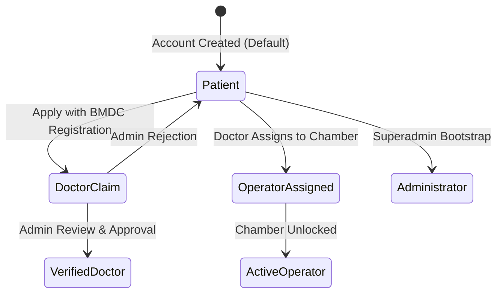
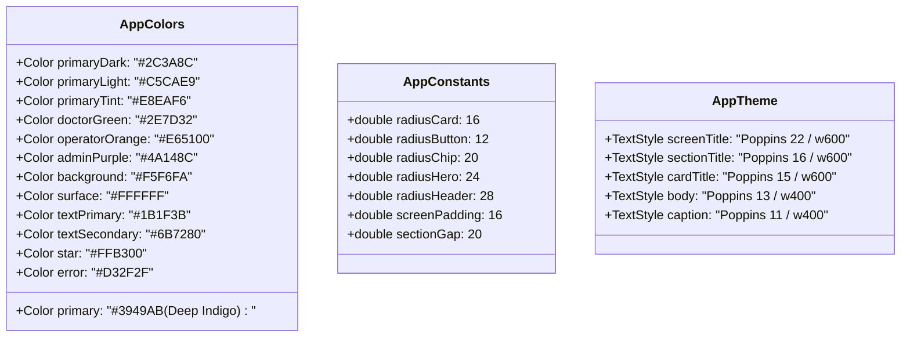
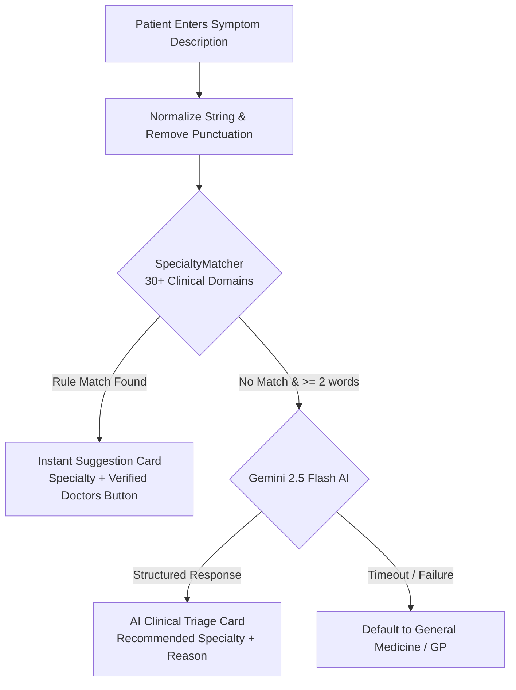
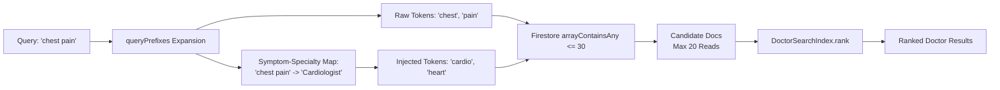
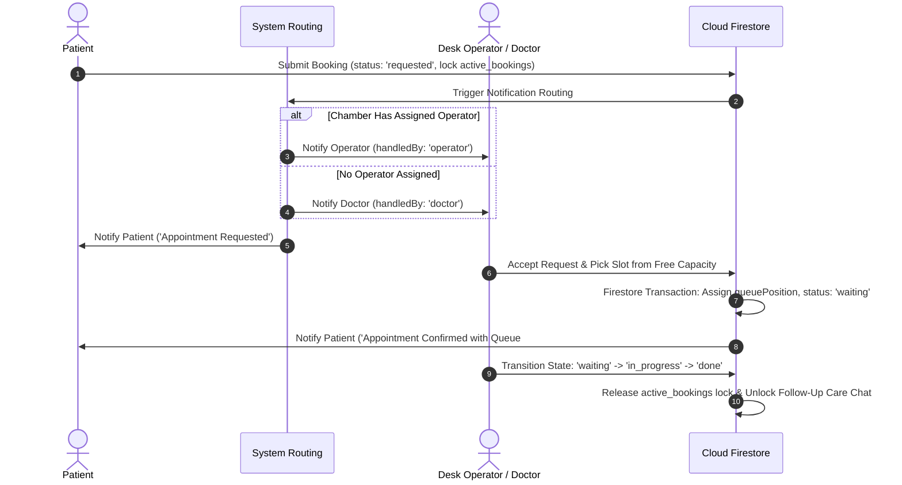
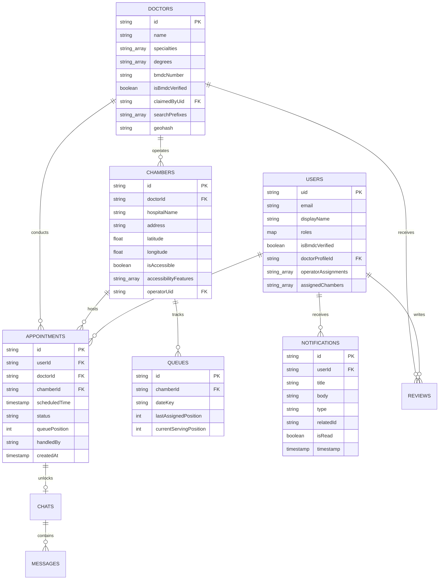

# Software Requirements Specification (SRS)

## Project: DoctorDesk — Smart Healthcare Coordination, Clinical Triage & Real-Time Queue Management Platform

---

### Document Control

| Attribute | Details |
| :--- | :--- |
| **Document Version** | 2.0.0 (Production Architecture Baseline) |
| **Document Status** | Approved / Living Specification |
| **Target Platform** | Flutter (Android / iOS) + Firebase Serverless Cloud Platform + Gemini Generative AI |
| **Firebase Project** | `docdesk-1e4cc` |
| **Last Updated** | November 2026 |
| **Standard Compliance** | IEEE Std 830-1998 / ISO/IEC/IEEE 29148:2018 |

---

### Revision History

| Version | Date | Author / Contributor | Description of Changes |
| :--- | :--- | :--- | :--- |
| **1.0.0** | September 2026 | Core Architecture Team | Initial prototype specification: Express + MongoDB backend, basic BMDC verification concept, early role hierarchy. |
| **1.5.0** | October 2026 | Engineering Team | Serverless migration to Cloud Firestore, 50k reads limit mitigation strategy, pre-bundled 6,000+ APK doctor directory, Geohash proximity engine. |
| **2.0.0** | November 2026 | Mobile & Systems Team | Full production specification: Bidirectional symptom↔specialty indexing (v2), Gemini 2.5 Flash triage fallback, Universal Accessibility (Global Read Aloud TTS & Doctor-Declared Disability Chambers), strict booking state machine & queue transactions, role-based Material 3 design token architecture, and assisted BM&DC administrative verification. |

---

## Table of Contents

1. [Introduction](#1-introduction)
   - 1.1 [Purpose](#11-purpose)
   - 1.2 [Scope](#12-scope)
   - 1.3 [Definitions, Acronyms, and Abbreviations](#13-definitions-acronyms-and-abbreviations)
   - 1.4 [Architectural Evolution](#14-architectural-evolution)
   - 1.5 [High-Level Architecture & Component Diagram](#15-high-level-architecture--component-diagram)
2. [Overall Description](#2-overall-description)
   - 2.1 [Product Perspective](#21-product-perspective)
   - 2.2 [Supported User Roles & Thematic Portals](#22-supported-user-roles--thematic-portals)
   - 2.3 [User Role State Machine & Transitions](#23-user-role-state-machine--transitions)
   - 2.4 [Operating Environment](#24-operating-environment)
   - 2.5 [Design & Implementation Constraints](#25-design--implementation-constraints)
   - 2.6 [Assumptions and Dependencies](#26-assumptions-and-dependencies)
3. [External Interface Requirements](#3-external-interface-requirements)
   - 3.1 [User Interfaces & Design Token System](#31-user-interfaces--design-token-system)
   - 3.2 [Hardware Interfaces](#32-hardware-interfaces)
   - 3.3 [Software Interfaces & Cloud Integrations](#33-software-interfaces--cloud-integrations)
   - 3.4 [Communications Interfaces](#34-communications-interfaces)
4. [System Features & Functional Requirements](#4-system-features--functional-requirements)
   - 4.1 [Authentication & Global Identity Management](#41-authentication--global-identity-management)
   - 4.2 [Two-Tier Clinical Triage Engine](#42-two-tier-clinical-triage-engine)
   - 4.3 [Search Indexing, Geospatial Discovery & Directory Architecture](#43-search-indexing-geospatial-discovery--directory-architecture)
   - 4.4 [Chamber Queue Operations & Dynamic Scheduling Algorithm](#44-chamber-queue-operations--dynamic-scheduling-algorithm)
   - 4.5 [Universal Accessibility & Disability-Friendly Chambers](#45-universal-accessibility--disability-friendly-chambers)
   - 4.6 [Post-Care Telemedicine & Follow-Up Messaging](#46-post-care-telemedicine--follow-up-messaging)
   - 4.7 [Patient Health Document Vault & Medical Journal](#47-patient-health-document-vault--medical-journal)
   - 4.8 [Administrative Console & BM&DC Verification Portal](#48-administrative-console--bmdc-verification-portal)
5. [Non-Functional Requirements](#5-non-functional-requirements)
   - 5.1 [Performance & Quota Optimization](#51-performance--quota-optimization)
   - 5.2 [Security & Data Protection](#52-security--data-protection)
   - 5.3 [Reliability, Availability & Offline Resilience](#53-reliability-availability--offline-resilience)
   - 5.4 [Usability & Universal Accessibility](#54-usability--universal-accessibility)
   - 5.5 [Maintainability & Code Hygiene](#55-maintainability--code-hygiene)
6. [Data Model & Firestore Schema Specifications](#6-data-model--firestore-schema-specifications)
   - 6.1 [Entity Relationship Diagram](#61-entity-relationship-diagram)
   - 6.2 [Firestore Collection Schemas](#62-firestore-collection-schemas)
   - 6.3 [Composite Index Specifications](#63-composite-index-specifications)
7. [Verification, Validation & Quality Gates](#7-verification-validation--quality-gates)
   - 7.1 [Firestore Rules Unit Test Suite](#71-firestore-rules-unit-test-suite)
   - 7.2 [Static Analysis & Code Quality Gate](#72-static-analysis--code-quality-gate)
   - 7.3 [Booking Lifecycle Acceptance Matrix](#73-booking-lifecycle-acceptance-matrix)

---

## 1. Introduction

### 1.1 Purpose
This Software Requirements Specification (SRS) provides a definitive, comprehensive technical and functional specification for **DoctorDesk**. It establishes the functional, architectural, interface, performance, and security requirements governing the DoctorDesk mobile application and its serverless cloud backplane. This document serves as the primary technical contract for software engineers, QA teams, project evaluators, and system architects.

### 1.2 Scope
DoctorDesk is an end-to-end healthcare coordination and clinical discovery platform engineered specifically for the healthcare delivery challenges of Bangladesh. The platform addresses four major systemic issues:
1. **Inefficient Specialist Discovery:** Patients frequently struggle to navigate fragmented clinical specialties or translate vernacular symptoms into medical disciplines.
2. **Chaotic Physical Chamber Queues:** Outpatient consultation queues suffer from unpredictable arrival times, lack of real-time visibility, manual ledger bottlenecks, and crowded waiting rooms.
3. **Medical Credential Fraud:** Unverified medical practice is combated through a rigorous administrative verification workflow cross-referencing Bangladesh Medical and Dental Council (BM&DC) registrations.
4. **Accessibility Barriers:** Visually impaired patients, elderly individuals, and citizens with physical disabilities face severe digital and physical accessibility deficits when seeking care.

The platform coordinates four core user roles—**Patient**, **Doctor**, **Chamber Operator**, and **Administrator**—through a single unified Flutter client delivering dedicated, contextually isolated thematic portals.

### 1.3 Definitions, Acronyms, and Abbreviations

| Term / Acronym | Definition |
| :--- | :--- |
| **BM&DC** | Bangladesh Medical and Dental Council, the statutory regulatory authority for medical practitioners in Bangladesh. |
| **UID** | Unique Identifier generated by Firebase Authentication upon account creation. |
| **Chamber** | A physical consultation room, outpatient clinic, or hospital practice facility where a doctor examines patients. |
| **Desk Operator** | Front-desk staff, clinic manager, or hospital assistant assigned by a doctor to manage patient queuing and appointments for a specific chamber. |
| **Geohash** | A hierarchical spatial data structure that subdivides coordinate space into a grid with base-32 string representations. |
| **Haversine Formula** | Mathematical formula calculating great-circle distances between two points on a sphere given their longitudes and latitudes. |
| **TTS** | Text-to-Speech synthesis technology converting textual labels and document strings into spoken audio. |
| **TTL** | Time-To-Live; duration after which a cached object, temporary record, or message window automatically expires. |
| **Spark Plan** | Google Firebase's free resource tier, strictly capping Cloud Firestore at 50,000 document reads, 20,000 writes, and 20,000 deletes per day. |
| **WCAG 2.1 AA** | Web Content Accessibility Guidelines Level AA standard for digital interface accessibility and contrast ratios. |

### 1.4 Architectural Evolution
The DoctorDesk platform underwent a major architectural migration to achieve high resilience, real-time synchronization, and zero-maintenance scalability:
- **Phase 1 (Legacy Prototype):** Hybrid architecture utilizing a custom Node.js (Express) + MongoDB REST backend for database and business logic, with Firebase Auth exclusively handling user identity. This prototype suffered from manual polling delays, backend hosting costs, and disconnected offline states.
- **Phase 2 (Modern Cloud Architecture):** Full migration to a **serverless event-driven architecture** leveraging **Google Cloud Firestore**, **Firebase Authentication**, **Firebase Cloud Storage**, and **Google Gemini 2.5 Flash Generative AI**. Security enforcement shifted from Express middleware to cryptographically verified Cloud Firestore and Storage Security Rules, backed by local emulator test suites. Directory browsing was optimized through asset-level bundling to eliminate Firestore read quota exhaustion.

### 1.5 High-Level Architecture & Component Diagram

```mermaid
flowchart TD
    subgraph Client_Layer [Flutter Cross-Platform Client (Dart)]
        UI_Shell[Main Shell & Dynamic Role Theme Controller]
        UI_Shell --> P_Portal[Patient Portal - Deep Indigo]
        UI_Shell --> D_Portal[Doctor Portal - Forest Green]
        UI_Shell --> O_Portal[Operator Desk - Vivid Orange]
        UI_Shell --> A_Portal[Admin Console - Deep Purple]
        
        TtsWrapper[_ReadAloudGestureWrapper\nGlobal TTS Interceptor] --> UI_Shell
    end

    subgraph Intelligence_Subsystem [Clinical Intelligence & Geospatial Engine]
        Matcher[Rule-Based Specialty Matcher\n30+ Clinical Domains]
        Gemini[Google Gemini 2.5 Flash\nClinical AI Fallback]
        GeoHaversine[Haversine Formula &\nGeohash Bounding Calculator]
        IndexEngine[Bidirectional Symptom-Specialty Indexer\nDoctorSearchIndex v2]
    end

    subgraph Storage_Caching [Storage & Offline Resilience]
        LocalVault[(Device SharedPreferences\nOffline Docs & Rules TTL Cache)]
        BundledData[(APK Asset Bundle\n6,000+ Pre-Bundled Doctors)]
    end

    subgraph Cloud_Infrastructure [Google Firebase Cloud Infrastructure (docdesk-1e4cc)]
        Auth[Firebase Authentication\nOAuth / Email / Phone]
        Firestore[(Cloud Firestore Realtime DB\nStrict Security Rules & Indexes)]
        CloudStorage[(Firebase Cloud Storage\nMedical Records & Certificates)]
    end

    Client_Layer --> Intelligence_Subsystem
    Client_Layer --> Storage_Caching
    Client_Layer <--> Cloud_Infrastructure
    Intelligence_Subsystem <--> Cloud_Infrastructure
```

---

## 2. Overall Description

### 2.1 Product Perspective
DoctorDesk is a self-contained mobile application client with zero external web server dependencies for primary workflows. It directly interfaces with Google Firebase managed services and Google AI Studio APIs. The system operates under a strict offline-first paradigm where catalog discovery, directory browsing, symptom rules, and basic triage remain fully operational even without internet connectivity.

### 2.2 Supported User Roles & Thematic Portals
DoctorDesk establishes strict role boundaries. Each role is visually reinforced through dynamic Material 3 design tokens:



1. **Patient (Primary Role — Deep Indigo `#3949AB`):**
   - Foundation role assigned to every registered account.
   - Discovers doctors via symptom search, specialty categorization, and geolocation.
   - Submits appointment requests, tracks live queue position, and writes verified chamber reviews.
   - Maintains a local-first medical document vault and daily health journal.
2. **Verified Doctor (Elevated Role — Forest Green `#2E7D32`):**
   - Unlocked exclusively when an administrator verifies the doctor's BM&DC credentials.
   - Configures multiple chamber locations, schedules, consultation fees, and accessibility accommodations.
   - Appoints chamber desk operators by assigning their user account to specific chambers.
   - Reviews incoming booking requests, inspects patient queue states, and engages in unlocked post-consultation care chats.
3. **Chamber Operator (Elevated Role — Vivid Orange `#E65100`):**
   - Front-desk manager authorized exclusively for chambers explicitly delegated by a doctor.
   - Operates the Chamber Desk queue: reviews incoming patient requests, allocates time slots, assigns sequential queue numbers (`queuePosition`), and marks visits completed.
   - Prevented from managing patient queues if no chamber assignments exist (displays Job Board / Assignment Status fallback).
4. **Administrator (Elevated Role — Deep Purple `#4A148C`):**
   - Administrative and verification authority.
   - Inspects pending doctor verification claims against the public BM&DC registry via an assisted web review console.
   - Manages doctor directory assignments, assigns orphan doctor profiles to authenticated emails, inspects system audit logs, and monitors Firestore backend latency.

### 2.3 User Role State Machine & Transitions
Identity is tied to a single immutable Firebase Authentication `uid`. Role permissions are stored within the Firestore document `users/{uid}` in the `roles` map:

```json
{
  "roles": {
    "isPatient": true,
    "isDoctor": false,
    "isOperator": false,
    "isAdmin": false
  },
  "isBmdcVerified": false,
  "doctorProfileId": null,
  "operatorAssignments": [],
  "assignedChambers": []
}
```

- **Doctor Verification Flow:**
  1. A patient navigates to *Settings $\rightarrow$ Apply / Claim Doctor Profile*.
  2. The user submits their full name, medical degrees, BM&DC registration number, and photographic verification of their certificate.
  3. The submission writes to `doctor_applications/{appId}` with status `pending`.
  4. An administrator opens the verification console, inspects the BM&DC registry match, and marks the application `approved`.
  5. The approval executes an administrative transaction setting `roles.isDoctor = true`, `isBmdcVerified = true`, and links `doctorProfileId`.
- **Operator Delegation Flow:**
  1. A doctor opens *Chamber Manager $\rightarrow$ Chamber Settings $\rightarrow$ Assign Operator*.
  2. The doctor inputs the target user's registered email or UID.
  3. The doctor executes a transaction that appends the chamber ID to the target user's `operatorAssignments` array and sets `roles.isOperator = true`.
  4. The operator's client detects the assignment in real time and unlocks the Chamber Desk portal.

### 2.4 Operating Environment
- **Client Platforms:** Android (minSdkVersion 26 / Android 8.0 Oreo, targetSdkVersion 34), iOS (iOS 14.0+).
- **Client Framework:** Flutter SDK version 3.24+ / Dart SDK version 3.5+.
- **Backend Infrastructure:** Google Cloud Firestore (Native mode, multi-region `nam5`), Google Firebase Authentication, Google Firebase Cloud Storage.
- **AI Infrastructure:** Google Gemini 2.5 Flash (`https://generativelanguage.googleapis.com/v1beta/models/gemini-2.5-flash:generateContent`).
- **Local Client Storage:** Android Shared Preferences / iOS NSUserDefaults.

### 2.5 Design & Implementation Constraints
1. **Firebase Spark Plan 50,000 Daily Reads Ceiling:** Unbounded collection queries are strictly prohibited. The system must operate under five quota-defense techniques:
   - Asset bundling for static catalog browsing (6,000+ doctors bundled in APK).
   - Array-contains-any search prefix queries capped at 30 items.
   - Cursor-based pagination (`startAfterDocument`) with maximum page size of 20 documents.
   - 24-hour cache TTL in device storage for remote configuration and triage rules.
   - Geohash spatial bounding ranges to restrict geospatial queries.
2. **Absence of Official BM&DC Public REST API:** The Bangladesh Medical and Dental Council does not offer a public programmatic API. Verification must be performed through an assisted in-app administrative web review with automated field prefilling. Direct automated scraping or CAPTCHA bypass is strictly prohibited.
3. **No In-App Payment Gateway:** To accommodate local physical clinic workflows, consultation fees are paid on arrival at the physical chamber desk. The app does not process live credit card/MFS transactions.
4. **Safety & Medical Disclaimers:** DoctorDesk is an administrative coordination and triage tool; it does not provide clinical diagnoses. Emergency alerts must redirect users to national emergency hotlines (e.g., 999).

### 2.6 Assumptions and Dependencies
- Users possess an active internet connection for real-time queue synchronization and appointment bookings (read-only cached features remain available offline).
- The device supports standard geolocation services (GPS or network-based location) for proximity discovery.
- Doctors provide valid BM&DC registration details during profile claiming.

---

## 3. External Interface Requirements

### 3.1 User Interfaces & Design Token System
DoctorDesk implements a centralized design token system defined in `AppColors`, `AppConstants`, and `AppTheme`:



- **Screen Header:** Full-width `#3949AB` header with a 28px bottom border radius, 44px circular user avatar, contextual greeting, notification bell with unread badge, and an integrated search bar with 14px border radius.
- **Floating Pill Bottom Navigation:** Floated navigation bar with 12px margins from edges, 24px border radius, `primaryTint` background, soft drop shadow, and permanent label visibility.
- **Scroll Clearance:** All scrollable views must enforce an explicit bottom padding of 88px to 96px combined with `SafeArea` wrapping to ensure floating navigation never obstructs interactive elements or system bars.
- **Contrast & Readability:** All text and icon combinations must meet or exceed the WCAG 2.1 AA minimum contrast threshold of 4.5:1 for normal text and 3:1 for large text/chips.

### 3.2 Hardware Interfaces
- **Touch Screen:** Multi-touch gesture recognition for standard navigation, reorderable queues, and accessibility interception (single-tap speech synthesis vs. double-tap navigation).
- **Audio Output:** Device speaker hardware utilized by the Text-to-Speech synthesis engine.
- **Location Sensor:** GPS/GNSS receiver accessed through standard platform location services for latitude/longitude coordinate acquisition.

### 3.3 Software Interfaces & Cloud Integrations
- **Firebase Authentication:** Handles user identity across Email/Password, Google OAuth (rendered with clean vector paths via custom canvas painter), and Phone OTP.
- **Cloud Firestore:** Primary NoSQL document database utilizing snapshot listeners for real-time bidirectional data synchronization.
- **Firebase Cloud Storage:** Object store for doctor credentials, patient medical records, and prescription attachments with role-guarded access rules.
- **Google Gemini 2.5 Flash API:** Cloud-hosted LLM utilized for descriptive symptom triage when local rule matching returns inconclusive results.
- **Flutter TTS Engine (`flutter_tts`):** Native platform speech synthesizer dynamically synchronized with app locale settings (`en-US` and `bn-BD`).

### 3.4 Communications Interfaces
- **Protocol:** Secure HTTPS over TLS 1.3 for all REST invocations (Gemini AI API).
- **Database Transport:** gRPC over HTTP/2 with persistent bidirectional WebSockets for Firestore real-time snapshot synchronization and transactional writes.
- **Security:** All transport communications are encrypted end-to-end. Client credentials communicate via signed Firebase ID Tokens cryptographically validated on Cloud Firestore.

---

## 4. System Features & Functional Requirements

### 4.1 Authentication & Global Identity Management

#### Description
Provides unified registration, authentication, role detection, and session management.

#### Functional Requirements
- **FR-AUTH-01:** The system shall support user authentication via Email/Password, Google OAuth, and Phone SMS OTP.
- **FR-AUTH-02:** Upon initial authentication, the system shall provision a base User document in `users/{uid}` with `roles.isPatient = true` and all elevated roles defaulted to `false`.
- **FR-AUTH-03:** The user profile shall support dynamic profile switching for accounts holding multiple elevated roles (e.g., Doctor who also functions as Patient).
- **FR-AUTH-04:** The authentication layer shall automatically persist session tokens and restore session states across cold application restarts without requiring re-login.
- **FR-AUTH-05:** Account deletion and logout shall immediately purge cached credentials and reset local in-memory role controllers.

---

### 4.2 Two-Tier Clinical Triage Engine

#### Description
Assists patients in identifying appropriate medical specialties based on natural language symptom descriptions in English, Bangla script, or Banglish.



#### Functional Requirements
- **FR-TRG-01 (Rule-Based Triage):** The system shall evaluate queries against `SpecialtyMatcher` covering 30+ medical domains with support for English, Bangla script (e.g., `বুকের ব্যথা`, `মাথা ঘোরা`), and Banglish phonetic representations (e.g., `buke chap`, `matha ghurache`).
- **FR-TRG-02 (Longest-Match-First):** The rule engine shall sort clinical keywords in descending order of string length prior to evaluation to guarantee specific matches (e.g., `"chest pain"` $\rightarrow$ Cardiology) supersede generic matches (e.g., `"pain"` $\rightarrow$ Physical Medicine).
- **FR-TRG-03 (Generative AI Fallback):** When rule matching produces no hit and the query length $\ge 2$ words (or $\ge 10$ characters), the system shall invoke **Gemini 2.5 Flash** with a strict medical triage prompt returning structured recommendations.
- **FR-TRG-04 (Fallback Resilience):** If Gemini 2.5 Flash encounters a network timeout or rate limit, the system shall fail over to `gemini-2.5-flash-lite`, and ultimately default gracefully to `"General Medicine"` without crashing.
- **FR-TRG-05 (Inline Search Card):** Entering symptoms directly into the home screen search bar shall trigger triage evaluation and surface a prominent, clickable recommendation card directly beneath the search input.

---

### 4.3 Search Indexing, Geospatial Discovery & Directory Architecture

#### Description
Enables rapid doctor discovery across 6,000+ practitioners while strictly adhering to Firestore's 50,000 daily read limit.



#### Functional Requirements
- **FR-SRC-01 (Bidirectional Symptom-Specialty Index):** The indexer shall store `searchText`, `searchTokens`, and `searchPrefixes` on doctor profiles. At index time, symptoms mapped to a doctor's specialty shall be automatically injected into their prefixes. Searching `"chest pain"` must directly retrieve cardiologists.
- **FR-SRC-02 (Multi-Specialty Indexing):** For doctors holding multiple specialties (e.g., *Medicine Specialist* and *Cardiology*), symptoms for all associated specialties must be indexed simultaneously into `searchPrefixes`.
- **FR-SRC-03 (Prefix Query Cap):** All array-contains queries against `searchPrefixes` shall be strictly capped at 30 items per query to satisfy Firestore engine limitations.
- **FR-SRC-04 (Multi-Hop Abbreviation Resolution):** The search engine shall resolve clinical abbreviations bidirectionally through expansion chains (`"ent"` $\leftrightarrow$ `"otolaryngology"`, `"gynae"` $\leftrightarrow$ `"gynecology"`, `"ortho"` $\leftrightarrow$ `"orthopedics"`, `"med"` $\leftrightarrow$ `"general medicine"`).
- **FR-SRC-05 (Relevance Scoring Matrix):** Candidate search results shall be ranked according to the following scoring matrix:
  - Exact Full Name Match: $+1000$ points.
  - Name Starts With Query: $+800$ points.
  - Core Word Match in Name: $+750$ points.
  - Symptom-to-Specialty Association: $+400$ points.
  - Alias Expansion Match: $+180$ points.
  - Medical Abbreviation Match: $+120$ points.
  - Degrees or Chamber Substring Match: $+40$ points.
  - Any unsatisfied query term: $-1$ (immediate disqualification).
- **FR-SRC-06 (Pre-Bundled APK Directory):** The application shall bundle a verified directory of 6,000+ doctors inside `assets/data/bundled_doctors.json`, allowing full offline browsing and search with **zero Firestore reads**.
- **FR-SRC-07 (Haversine Proximity Calculation):** Proximity between the user and medical chambers shall be computed using the Haversine formula ($R = 6371.0\text{ km}$):
  $$\Delta\phi = \text{radians}(\text{lat}_2 - \text{lat}_1), \quad \Delta\lambda = \text{radians}(\text{lon}_2 - \text{lon}_1)$$
  $$a = \sin^2\left(\frac{\Delta\phi}{2}\right) + \cos(\phi_1)\cos(\phi_2)\sin^2\left(\frac{\Delta\lambda}{2}\right), \quad c = 2\text{ atan2}(\sqrt{a}, \sqrt{1-a}), \quad d = R \cdot c$$
- **FR-SRC-08 (Geohash Spatial Bounding):** Cloud spatial queries shall query lexicographical Geohash ranges (`geohash >= bound.start` AND `geohash <= bound.end`) to isolate candidate records before Haversine distance ranking.

---

### 4.4 Chamber Queue Operations & Dynamic Scheduling Algorithm

#### Description
Coordinates appointment booking, smart notification routing, sequential queue position assignment, and real-time waiting room state management.



#### Functional Requirements
- **FR-APT-01 (Booking Submission & Slot Locking):** When a patient submits an appointment request, the system shall create an appointment document with `status = 'requested'` and write a reservation lock to `active_bookings/{userId}_{chamberId}_{date}` to prevent duplicate bookings.
- **FR-APT-02 (Self-Booking & Self-Operating Prevention):** Security rules and UI layers shall strictly forbid a doctor from booking appointments with their own `doctorProfileId`, and forbid an operator from creating `requested` appointments for a chamber they manage.
- **FR-APT-03 (Smart Routing Notification):**
  - If the target chamber has an assigned operator, the pending booking notification shall be dispatched exclusively to the chamber operator (`handledBy: 'operator'`).
  - If no operator is assigned, the notification shall route directly to the doctor (`handledBy: 'doctor'`).
  - The booking patient shall receive an `"Appointment Requested"` notification (not `"Confirmed"`).
- **FR-APT-04 (Atomic Queue Number Allocation):** Acceptance of an appointment must execute inside a Firestore transaction reading the daily queue counter document `queues/{chamberId}_{dateKey}`, incrementing `lastAssignedPosition`, and assigning that sequential integer to `appointment.queuePosition`.
- **FR-APT-05 (Desk Queue State Machine):** The queue operator shall transition appointments through the strictly ordered lifecycle:
  $$\text{requested} \longrightarrow \text{waiting} \longrightarrow \text{in\_progress} \longrightarrow \text{done}$$
  *(Alternative terminal states: `cancelled` or `no_show`).*
- **FR-APT-06 (Visit Completion & Follow-up Unlock):** Marking an appointment `done` shall release the `active_bookings` write lock and provision an active post-care chat session in `chats/{appointmentId}`.
- **FR-APT-07 (Unified Query Builder):** All appointment queries across Patient, Doctor, and Operator screens must route through `AppointmentQueries` to ensure consistent filtering on `chamberId`, `doctorId`, and timestamps.

---

### 4.5 Universal Accessibility & Disability-Friendly Chambers

#### Description
Ensures full digital and physical accessibility for elderly, visually impaired, and physically disabled patients.

```mermaid
flowchart TD
    subgraph Digital_Accessibility [Digital: Global Read Aloud TTS]
        Tap[User Touch Event] --> Wrapper[_ReadAloudGestureWrapper]
        Wrapper --> Check{TtsService.isEnabled?}
        Check -- Single Tap --> Speak[flutter_tts: Extract & Speak Semantic Label]
        Check -- Double Tap within 350ms --> Trigger[Trigger Interactive Navigation / Action]
    end

    subgraph Physical_Accessibility [Physical: Disability-Friendly Chambers]
        DocMgr[Doctor Manager] --> Toggle[Toggle: Disability-friendly chamber]
        Toggle --> Chips[Select Accommodations:\nRamp | Lift | Accessible Washroom | Ground Floor]
        Chips --> Publish[Store in Chamber Model isAccessible: true]
        Publish --> Label[Render Badge with Mandatory Disclaimer:\n'Doctor-declared accessible chamber']
    end
```

#### Functional Requirements
- **FR-ACC-01 (Doctor-Declared Accessibility):** Doctors may declare physical accommodations for any chamber by selecting from verified feature tags:
  - `Ramp` (Wheelchair ramp access)
  - `Lift/Elevator` (Vertical elevator access)
  - `Accessible washroom` (Wheelchair-accessible restroom facilities)
  - `Ground floor` (Step-free ground floor entrance)
- **FR-ACC-02 (Ethical Transparency):** All accessibility badges displayed on discovery cards and detail pages must include the explicit caption: *"This is declared by the doctor"* to avoid misrepresenting doctor declarations as third-party certifications.
- **FR-ACC-03 (Accessible Chamber Filter):** Discovery screens shall provide an `"Accessible only"` filter chip filtering results on `doctor.hasAccessibleChamber`.
- **FR-ACC-04 (Global Read Aloud Interceptor):** The application shall embed `_ReadAloudGestureWrapper` at the `MaterialApp` root builder:
  - **Single Tap:** Speaks the tapped element's semantic text or label via `TtsService` without blocking user gestures.
  - **Double Tap:** Detects two taps within a 350ms window and 40px radius, executing the underlying navigation or interactive action.
- **FR-ACC-05 (Locale Synchronization):** The TTS engine shall dynamically switch synthesis language between `en-US` and `bn-BD` matching the application's active language setting.
- **FR-ACC-06 (Accessibility Setting Tile):** A standardized `ReadAloudSettingTile` must appear in an `"ACCESSIBILITY"` section placed immediately above `"PREFERENCES"` in Patient Settings, Doctor Practice Settings, and Operator Desk Settings.

---

### 4.6 Post-Care Telemedicine & Follow-Up Messaging

#### Description
Facilitates controlled, safe digital communication between patients and doctors following a completed in-person consultation.

#### Functional Requirements
- **FR-MSG-01 (Strict Post-Care Gate):** Chat messaging channels between a patient and doctor shall remain strictly locked until an appointment reaches the terminal status `done`.
- **FR-MSG-02 (Safety & TTL Enforcement):** Each chat channel shall enforce an explicit message quota (`chat.messageLimit`) and time expiration window (`chat.expiresAt`, default 7 calendar days post-consultation).
- **FR-MSG-03 (Firestore Rule Guards):** Firestore rules governing message creation must guard existence checks:
  `(!('expiresAt' in chat) || request.time < chat.expiresAt) && (!('messageLimit' in chat) || chat.messageCount < chat.messageLimit)`.
- **FR-MSG-04 (Attachment Support):** Patients and doctors may upload images, laboratory reports, and prescription photos securely through Firebase Cloud Storage.

---

### 4.7 Patient Health Document Vault & Medical Journal

#### Description
Provides a secure, client-side digital repository for personal medical records and daily wellness tracking.

#### Functional Requirements
- **FR-VLT-01 (Client-Side Storage by Default):** Health documents, prescription records, and diagnostic scans shall be stored in encrypted local device storage (`SharedPreferences` / application sandboxed directory).
- **FR-VLT-02 (Zero-Knowledge Privacy):** Medical records shall never be transmitted to Cloud Storage or Firestore until the patient explicitly initiates an on-demand cloud share with a consulting practitioner.
- **FR-VLT-03 (Health Journaling):** The system shall provide daily journal logging for blood pressure, blood glucose, body temperature, and symptom progression.

---

### 4.8 Administrative Console & BM&DC Verification Portal

#### Description
Empowers system administrators to review practitioner credentials, manage directories, inspect system health, and safeguard database hygiene.

#### Functional Requirements
- **FR-ADM-01 (Assisted BM&DC Verification):** The verification screen shall open the official BM&DC registry portal inside an administrative WebView and prefill the doctor's registration number into the form input.
- **FR-ADM-02 (Manual Verification Policy):** The verification script shall not execute automated form submission (`btn.click()`) or bypass CAPTCHA protections. The administrator must visually evaluate registry records and manually approve or reject the application.
- **FR-ADM-03 (Doctor Profile Assignment):** Administrators shall possess the ability to link orphaned doctor directory documents with newly authenticated user email addresses.
- **FR-ADM-04 (Debug Tool Safeguarding):** Destructive actions (e.g., appointment purge, local storage wipe, role impersonation) must be wrapped inside `if (kDebugMode)` checks to prevent execution in production release builds.

---

## 5. Non-Functional Requirements

### 5.1 Performance & Quota Optimization
- **NFR-PERF-01 (Firestore Read Ceiling):** Total daily Firestore reads across all system activities must not exceed **50,000 document reads per day** on the Firebase Spark tier.
- **NFR-PERF-02 (Directory Search Latency):** In-memory directory searches across bundled doctor records must return results within $\le 150\text{ms}$. Cloud prefix queries must return candidate doctors within $\le 800\text{ms}$.
- **NFR-PERF-03 (Clinical Triage Latency):** Rule-based triage matches must resolve in $\le 50\text{ms}$. Gemini 2.5 Flash generative triage evaluations must resolve in $\le 2.5\text{s}$.
- **NFR-PERF-04 (Cache TTL):** Remote clinical rules and configuration documents must be cached locally in `SharedPreferences` with a 24-hour Time-To-Live.

### 5.2 Security & Data Protection
- **NFR-SEC-01 (Role-Based Access Control):** All Firestore write, update, and delete mutations must be validated against cryptographically signed Firebase ID Tokens and role permissions defined in `firestore.rules`.
- **NFR-SEC-02 (Data Isolation):** Patients must only be permitted to read their own appointments, health records, and notification streams (`resource.data.userId == request.auth.uid`).
- **NFR-SEC-03 (Operator Chamber Isolation):** Operators can only read and manage appointments belonging to chambers explicitly listed in their `operatorAssignments` array.
- **NFR-SEC-04 (Storage Rules Enforcement):** Files stored in Firebase Cloud Storage must validate user authentication, file size ($\le 10\text{MB}$), and allowed MIME types (`image/jpeg`, `image/png`, `application/pdf`).

### 5.3 Reliability, Availability & Offline Resilience
- **NFR-REL-01 (Three-Tier Offline Resilience):**
  1. On first load, directory data, specialty classifications, and counts are persisted to device storage.
  2. If network connectivity fails, the application falls back immediately to local cache with zero Firestore reads, displaying an amber *"Offline mode"* banner.
  3. Under zero circumstances shall network drops result in blank screens or fatal unhandled exceptions.
- **NFR-REL-02 (Atomic Transactions):** All queue number increments, appointment acceptances, and role elevations must execute within Firestore ACID transactions.

### 5.4 Usability & Universal Accessibility
- **NFR-ACC-01 (Contrast Ratios):** All interface widgets must satisfy WCAG 2.1 AA minimum contrast ratios (4.5:1 for standard body text, 3:1 for large headings and icons).
- **NFR-ACC-02 (Screen Reader & TTS Support):** Every interactive button, image, and status badge must declare clear semantic labels accessible to both platform screen readers and DoctorDesk's Global Read Aloud engine.
- **NFR-ACC-03 (Bilingual Support):** The interface must support full localization in English (`en`) and Bengali (`bn`).

### 5.5 Maintainability & Code Hygiene
- **NFR-MNT-01 (Code Quality):** The codebase must compile cleanly under `flutter analyze` with zero errors and zero critical warnings.
- **NFR-MNT-02 (Single Source of Truth):** All Firestore appointment queries must be centralized in `lib/services/appointment_queries.dart`. Screen widgets must not construct custom ad-hoc appointment queries.

---

## 6. Data Model & Firestore Schema Specifications

### 6.1 Entity Relationship Diagram



### 6.2 Firestore Collection Schemas

#### 1. `users/{uid}`
```json
{
  "uid": "mMOqrPAdtIRH5a76t7Fx1ky8Bp83",
  "email": "user@mail.com",
  "displayName": "Dr. Mashrafi Elahi",
  "phone": "+8801700000000",
  "roles": {
    "isPatient": true,
    "isDoctor": true,
    "isOperator": false,
    "isAdmin": false
  },
  "isBmdcVerified": true,
  "doctorProfileId": "doctor_mMOqrPAdtIRH5a76t7Fx1ky8Bp83",
  "operatorAssignments": ["chamber-1793458283033"],
  "assignedChambers": ["chamber-1793458283033"],
  "createdAt": "2026-10-15T08:00:00Z",
  "updatedAt": "2026-11-01T12:00:00Z"
}
```

#### 2. `doctors/{doctorId}`
```json
{
  "id": "doctor_mMOqrPAdtIRH5a76t7Fx1ky8Bp83",
  "name": "Dr. Mashrafi Elahi",
  "degrees": ["MBBS", "FCPS (Medicine)"],
  "specialties": ["General Medicine", "Cardiology"],
  "bmdcNumber": "A-84920",
  "isBmdcVerified": true,
  "claimedByUid": "mMOqrPAdtIRH5a76t7Fx1ky8Bp83",
  "rating": 4.9,
  "reviewCount": 128,
  "searchText": "dr mashrafi elahi medicine cardiology heart chest pain ...",
  "searchTokens": ["dr", "mashrafi", "elahi", "medicine", "cardiology", "heart", "chest", "pain"],
  "searchPrefixes": ["dr", "ma", "mas", "mash", "el", "ela", "med", "car", "cardio", "hea", "che"],
  "chambers": [
    {
      "id": "chamber-1793458283033",
      "hospitalName": "BUP Medical Center",
      "address": "Mirpur Cantonment, Section 12, Dhaka",
      "latitude": 23.8398,
      "longitude": 90.3582,
      "geohash": "wh0r6m",
      "consultationFee": 800,
      "isAccessible": true,
      "accessibilityFeatures": ["Ramp", "Lift/Elevator", "Accessible washroom"],
      "operatorUid": "5rNRlLLaczZ65NuqsTSPE0kf2Pr1"
    }
  ]
}
```

#### 3. `appointments/{appointmentId}`
```json
{
  "id": "KgQQ9fJBcjofliWXmc4v",
  "userId": "LEPN8RB9Oeg5vXKX76plaXD57Zz2",
  "patientName": "Tariq Ahmed",
  "patientPhone": "+8801811111111",
  "doctorId": "doctor_mMOqrPAdtIRH5a76t7Fx1ky8Bp83",
  "doctorName": "Dr. Mashrafi Elahi",
  "chamberId": "chamber-1793458283033",
  "chamberName": "BUP Medical Center",
  "scheduledTime": "2026-11-02T04:00:00Z",
  "status": "waiting",
  "queuePosition": 4,
  "handledBy": "operator",
  "activeLockKey": "LEPN8RB9Oeg5vXKX76plaXD57Zz2_chamber-1793458283033_2026-11-02",
  "createdAt": "2026-11-01T09:30:00Z",
  "updatedAt": "2026-11-01T10:15:00Z"
}
```

#### 4. `queues/{chamberId}_{dateKey}`
```json
{
  "chamberId": "chamber-1793458283033",
  "dateKey": "2026-11-02",
  "lastAssignedPosition": 14,
  "currentServingPosition": 3,
  "updatedAt": "2026-11-02T10:00:00Z"
}
```

#### 5. `notifications/{notificationId}`
```json
{
  "id": "notif-982347192",
  "userId": "5rNRlLLaczZ65NuqsTSPE0kf2Pr1",
  "recipientId": "5rNRlLLaczZ65NuqsTSPE0kf2Pr1",
  "title": "New Appointment Request",
  "body": "Tariq Ahmed requested an appointment for Nov 2 at BUP Medical Center.",
  "type": "appointment_request",
  "relatedId": "KgQQ9fJBcjofliWXmc4v",
  "isRead": false,
  "timestamp": "2026-11-01T09:30:05Z"
}
```

#### 6. `chats/{chatId}`
```json
{
  "id": "chat_KgQQ9fJBcjofliWXmc4v",
  "appointmentId": "KgQQ9fJBcjofliWXmc4v",
  "patientUid": "LEPN8RB9Oeg5vXKX76plaXD57Zz2",
  "doctorUid": "mMOqrPAdtIRH5a76t7Fx1ky8Bp83",
  "messageCount": 4,
  "messageLimit": 20,
  "expiresAt": "2026-11-09T04:00:00Z",
  "createdAt": "2026-11-02T05:30:00Z"
}
```

### 6.3 Composite Index Specifications
To support multi-field querying under strict security rules, `firestore.indexes.json` mandates the following composite indexes:

| Collection | Indexed Fields | Query Purpose |
| :--- | :--- | :--- |
| `appointments` | `chamberId` (ASC), `status` (ASC), `createdAt` (DESC) | Operator desk request review sorted by time |
| `appointments` | `doctorId` (ASC), `status` (ASC), `createdAt` (DESC) | Doctor direct appointment requests |
| `appointments` | `chamberId` (ASC), `status` (ASC), `scheduledTime` (ASC) | Today's chamber desk active queue order |
| `appointments` | `doctorId` (ASC), `status` (ASC), `scheduledTime` (ASC) | Doctor's active patient consultation queue |
| `notifications`| `userId` (ASC), `timestamp` (DESC) | User notification bell and stream listener |
| `doctors`      | `searchPrefixes` (ARRAY), `rating` (DESC) | Ranked prefix search discovery |

---

## 7. Verification, Validation & Quality Gates

### 7.1 Firestore Rules Unit Test Suite
Security rules must be validated against the local Firebase Emulator Suite (`@firebase/rules-unit-testing`). The test suite asserts:
1. Unauthenticated users cannot read or write user profiles or appointment records.
2. Patients cannot mutate appointments once submitted, except to cancel their own pending booking.
3. Doctors and operators cannot read chats belonging to other practitioners.
4. Operators cannot assign appointments to chambers for which they are not assigned.
5. Rules evaluations cleanly tolerate absent optional fields (`expiresAt`, `messageLimit`).

Execution command:
```bash
firebase emulators:exec --only firestore "npm --prefix test/emulator test"
```

### 7.2 Static Analysis & Code Quality Gate
Every code commit must pass the Flutter analyzer without warnings or errors:
```bash
flutter analyze
```

### 7.3 Booking Lifecycle Acceptance Matrix

| Step | State / Transition | Expected System Behavior | Acceptance Criteria |
| :--- | :--- | :--- | :--- |
| **1** | Submit Booking | User submits date & chamber | Doc written with status `'requested'`, `active_bookings` write lock set. |
| **2** | Notification | Smart routing evaluated | If chamber has operator, operator notified; if not, doctor notified; patient notified of request. |
| **3** | Acceptance | Operator/Doctor taps Accept | Modal presents calculated free time slots; selects slot. |
| **4** | Queue Position | Transaction commits | `queuePosition` assigned sequentially from `queues/` doc; status becomes `'waiting'`. |
| **5** | Serving | Desk operator calls patient | Status transitions to `'in_progress'`. |
| **6** | Completion | Visit concluded | Status becomes `'done'`, `active_bookings` lock released, follow-up chat channel unlocked for 7 days. |

---

### End of Specification
